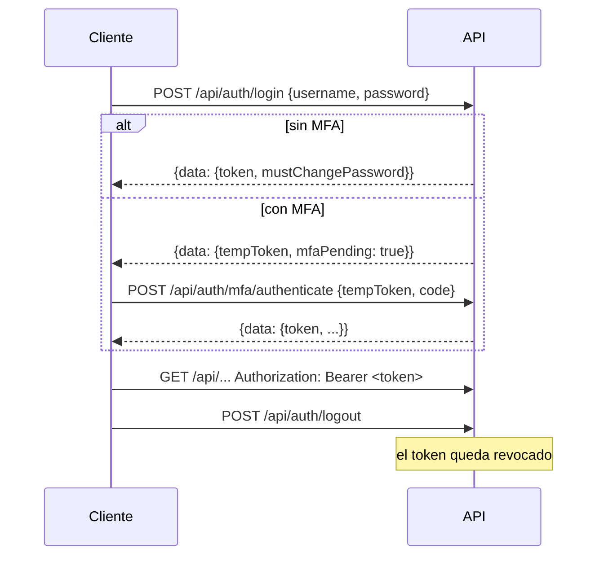

# API

Bitácora Ops expone una API HTTP JSON bajo `/api`. Es la misma que usa el frontend, así que todo lo que se hace en pantalla se puede hacer por API con los mismos permisos.

- [Conceptos](#conceptos)
- [Autenticación](#autenticación)
- [Formato de respuestas](#formato-de-respuestas)
- [Errores](#errores)
- [Límites de uso](#límites-de-uso)
- [Eventos en vivo](#eventos-en-vivo)
- [Referencia de rutas](#referencia-de-rutas)

---

## Conceptos

| Concepto | Valor |
| --- | --- |
| URL base | La de `PUBLIC_BASE_URL`, por ejemplo `http://127.0.0.1:8081/api` |
| Formato | JSON (UTF-8). Algunas rutas reciben o devuelven CSV, imágenes o archivos. |
| Fechas | ISO 8601 / RFC 3339 con zona (`2026-10-12T09:00:00-03:00`). Los días sueltos van como `AAAA-MM-DD`. |
| Identificadores | UUID |
| Auditoría | Toda ruta que **escribe** queda registrada en la Auditoría. Una prueba automática lo exige. |

---

## Autenticación



- El token es un **JWT** que dura **8 horas**. El `tempToken` del segundo factor dura 5 minutos.
- Se envía en cada petición como `Authorization: Bearer <token>`.
- `POST /api/auth/logout` agrega el token a una lista de revocación: deja de servir aunque no haya vencido.
- Con `mustChangePassword: true`, solo se puede cambiar la contraseña hasta hacerlo. El resto responde `403`.

**Ejemplo:**

```bash
curl -s -X POST http://127.0.0.1:8081/api/auth/login \
  -H 'Content-Type: application/json' \
  -d '{"username":"analista1","password":"********"}'
```

```json
{"data":{"token":"eyJhbGciOiJIUzI1NiIs...","mustChangePassword":false}}
```

### Niveles de acceso

En la tabla de rutas, la columna **Acceso** usa estos niveles:

| Acceso | Significa |
| --- | --- |
| Pública | Sin token. |
| Sesión | Cualquier usuario con sesión. |
| Admin | Rol administrador. |
| Admin o analista | Administrador o analista (no auditor ni invitado). |
| Admin o auditor | Administrador o auditor. |
| · módulo SOC / NOC | Además, la instalación tiene ese módulo encendido **y** el usuario lo tiene en su alcance. Si no, `403`. |
| · Ticketera encendida | Además, el módulo Ticketera está encendido. |
| · Complementos encendidos | Además, la funcionalidad Complementos está encendida. |
| Permiso `x:y` | El usuario tiene esa capacidad por un grupo de permisos. El administrador la tiene siempre. |
| Token de complemento | Solo para complementos, con un token propio y un permiso por ruta. No lo usa el frontend. |

---

## Formato de respuestas

Las respuestas exitosas vienen envueltas en `data`. Las listas paginadas agregan `meta`:

```json
{
  "data": [ { "id": "6f1c…", "name": "Phishing detectado" } ],
  "meta": { "page": 1, "pageSize": 50, "total": 1858 }
}
```

Las acciones sin contenido que devolver responden `204 No Content`.

---

## Errores

Los errores siguen **RFC 7807 (Problem Details)**:

```json
{
  "type": "https://bitacorasoc.local/errors/invalid-credentials",
  "title": "Unauthorized",
  "status": 401,
  "detail": "credenciales inválidas",
  "instance": "/api/auth/login"
}
```

- `detail` está en español y se puede mostrar al usuario.
- El final de `type` (`invalid-credentials`, `missing-token`, `invalid-payload`…) sirve para distinguir casos por código.

| Código | Cuándo |
| --- | --- |
| `400` | Datos inválidos (`invalid-payload`, `invalid-query`) |
| `401` | Sin token, token vencido o revocado, credenciales inválidas |
| `403` | Sin rol, módulo o permiso; o cambio de contraseña pendiente |
| `404` | No existe o no es visible para ti |
| `409` | Conflicto (por ejemplo, un nombre duplicado) |
| `429` | Demasiados intentos (ver límites) |
| `500` | Error interno: el detalle queda en el log del servidor |

---

## Límites de uso

| Qué | Límite | Ventana |
| --- | --- | --- |
| Login fallido por IP | 5 intentos | 15 min (guardado en PostgreSQL) |
| API sin sesión, por IP | 300 peticiones | 15 min |
| API con sesión, por usuario | 1.200 peticiones | 15 min |
| PIN del enlace público de un ticket | 30 intentos por enlace | 15 min |

Para desbloquear en una emergencia: [operacion.md](operacion.md#desbloquear-el-login).

---

## Eventos en vivo

`GET /api/stream/events` es un flujo **Server-Sent Events** autenticado con la misma cabecera `Authorization`. El frontend lo abre con `fetch` (no con `EventSource`) para poder mandar esa cabecera.

- Cada mensaje trae `id`, `event: <tipo>` y `data: <json>`.
- Al reconectar se envía `Last-Event-ID` y el servidor repite lo que se perdió.
- Detrás de un proxy hay que desactivar el búfer (en Caddy, `flush_interval -1`).

---

## Referencia de rutas

Generada desde `backend-go/cmd/server/main.go`, donde se registran las rutas. Las rutas con `{id}` llevan el identificador en esa posición. Los cuerpos de cada ruta están en los `struct` de petición de `backend-go/internal/handler/`.
<!-- generado desde cmd/server/main.go: 280 rutas -->

### Salud

| Método | Ruta | Acceso |
| --- | --- | --- |
| `GET` | `/api/health/live` | Pública |
| `GET` | `/api/health/ready` | Pública |

### Eventos en vivo (SSE)

| Método | Ruta | Acceso |
| --- | --- | --- |
| `GET` | `/api/stream/events` | Sesión |

### Asistente inicial

| Método | Ruta | Acceso |
| --- | --- | --- |
| `GET` | `/api/setup/status` | Pública |
| `POST` | `/api/setup/bootstrap` | Pública |

### Autenticación

| Método | Ruta | Acceso |
| --- | --- | --- |
| `POST` | `/api/auth/login` | Pública |
| `POST` | `/api/auth/mfa/authenticate` | Pública |
| `POST` | `/api/auth/mfa/setup` | Sesión |
| `POST` | `/api/auth/mfa/verify` | Sesión |
| `POST` | `/api/auth/mfa/disable` | Sesión |
| `GET` | `/api/auth/password-policy` | Pública |
| `POST` | `/api/auth/logout` | Sesión (también con cambio de clave pendiente) |
| `POST` | `/api/auth/forgot-password` | Pública |
| `POST` | `/api/auth/reset-password` | Pública |

### Usuarios

| Método | Ruta | Acceso |
| --- | --- | --- |
| `GET` | `/api/users/me` | Sesión (también con cambio de clave pendiente) |
| `PATCH` | `/api/users/me` | Sesión (también con cambio de clave pendiente) |
| `PUT` | `/api/users/me/password` | Sesión (también con cambio de clave pendiente) |
| `GET` | `/api/users/me/capabilities` | Sesión |
| `GET` | `/api/users` | Admin |
| `GET` | `/api/users/cargos` | Admin |
| `POST` | `/api/users` | Admin |
| `PATCH` | `/api/users/{id}` | Admin |
| `DELETE` | `/api/users/{id}` | Admin — `200 {deleted}`: borra de verdad (y de todos lados) a quien no tiene historial; si tiene, queda bloqueado (`deleted: false`). No a uno mismo (`409`) |
| `GET` | `/api/users/{id}/links` | Admin — lo que tiene a su nombre antes de bloquearlo: `[{kind: guard\|escalation\|pool\|shift\|client\|ticket\|task\|goal\|asset, label, detail}]` (en `guard`, `detail` = turnos por venir) |
| `POST` | `/api/users/force-reset-all` | Admin |
| `POST` | `/api/users/import` | Admin — `?dryRun=true` revisa sin guardar; cuerpo CSV (hasta 5 MB; no se guarda). Por usuario: crea (con `secret`, la contraseña temporal, que se muestra una vez) o actualiza; `areas` deja a la persona en esas áreas y niveles. `200 {rows, created, updated, unchanged, errors, applied}` |
| `GET` | `/api/users/import/template` | Admin |
| `GET` | `/api/users/export` | Admin — los usuarios activos en el formato de la carga |
| `GET` | `/api/users/{id}/permission-groups` | Admin |
| `PUT` | `/api/users/{id}/permission-groups` | Admin |
| `GET` | `/api/users/{id}/placement` | Admin |
| `PUT` | `/api/users/{id}/placement` | Admin |
| `GET` | `/api/users/{id}/channels` | Sesión |
| `POST` | `/api/users/{id}/channels` | Admin |
| `DELETE` | `/api/users/{id}/channels/{channelId}` | Admin |

### Grupos de permisos

| Método | Ruta | Acceso |
| --- | --- | --- |
| `GET` | `/api/permission-groups` | Sesión |
| `POST` | `/api/permission-groups` | Admin |
| `PATCH` | `/api/permission-groups/{id}` | Admin |

### Áreas y niveles

| Método | Ruta | Acceso |
| --- | --- | --- |
| `GET` | `/api/areas` | Admin |
| `POST` | `/api/areas` | Admin |
| `PATCH` | `/api/areas/{code}` | Admin |
| `GET` | `/api/areas/{code}/usage` | Admin — su gente y sus datos (`empty` = se puede borrar) |
| `DELETE` | `/api/areas/{code}` | Admin — solo un área vacía; SOC y NOC no se borran |
| `POST` | `/api/areas/{code}/merge` | Admin — `{into}`: toda su gente (con su nivel) y sus datos pasan al área destino; queda vacía |
| `GET` | `/api/areas/{code}/people` | Admin |
| `POST` | `/api/areas/{code}/people` | Admin |
| `GET` | `/api/departments` | Admin — departamentos con sus áreas, las que comparten equipo y su jefatura |
| `POST` | `/api/departments` | Admin — `{name}`; crea también su grupo de jefatura |
| `PATCH` | `/api/departments/{id}` | Admin — `{name?, areas?, shared?}`; marcar áreas que comparten equipo iguala su gente |
| `PUT` | `/api/departments/{id}/leads` | Admin — `{userIds}`: jefatura de todas sus áreas |
| `DELETE` | `/api/departments/{id}` | Admin — sus áreas quedan sin departamento |
| `GET` | `/api/levels` | Admin |
| `POST` | `/api/levels` | Admin |
| `PUT` | `/api/levels/order` | Admin |
| `PATCH` | `/api/levels/{id}` | Admin |

### Mi equipo (jefatura de área)

| Método | Ruta | Acceso |
| --- | --- | --- |
| `GET` | `/api/team/areas` | Capacidad `area:lead` o auditor — cada área con `lead` (es jefatura) y `quality` (usa la Bitácora); el auditor ve solo las de Calidad |
| `GET` | `/api/team?area=` | Capacidad `area:lead` |
| `GET` | `/api/team/people/{id}/tickets?area=` | Capacidad `area:lead` |
| `POST` | `/api/team/people` | Capacidad `area:lead` |
| `PUT` | `/api/team/people/{id}/group` | Capacidad `area:lead` |
| `GET` | `/api/team/candidates?area=` | Capacidad `area:lead` — cuentas activas que no están en el área (la jefatura no ve administradores) |
| `POST` | `/api/team/people/{id}/join` | Capacidad `area:lead` — `{area, groupId}`: suma al área a alguien que ya tiene cuenta |
| `DELETE` | `/api/team/people/{id}?area=` | Capacidad `area:lead` — lo saca del área (sus grupos del área); la cuenta sigue activa |
| `GET` | `/api/team/monthly?area=&month=YYYY-MM` | Capacidad `area:lead` — resumen mensual del área: por persona y total (tareas, a tiempo, hechas tarde, atrasos abiertos, omitidas, tickets resueltos, dentro del SLA, días ausente), `frozen` y los porcentajes del mes anterior. En áreas con Bitácora, `entries` y `quality` por persona (10f); la respuesta trae `bitacora` y `tickets` (Ticketera encendida) |
| `POST` | `/api/team/monthly/send` | Capacidad `area:lead` — `{area, month, to: [correos]}` (1 a 30, dominios válidos de Reportes) |
| `GET` | `/api/team/quality?area=&days=7\|15\|30` o `&month=YYYY-MM` | Capacidad `area:lead` (sus áreas) o auditor (todas) — puntaje de calidad de registro por persona (10f): entradas, turnos, puntaje, estado, ausencia y las 7 reglas con porcentaje, puntos, si pasa el límite y ejemplos. `404` si el área no usa la Bitácora |
| `GET` | `/api/team/departments` | Capacidad `area:lead` o auditor — los departamentos que dirige (el admin, todos; el auditor, los que tienen Calidad). `GET /api/team`, `/api/team/monthly` y `/api/team/quality` aceptan `?department=` |

### Configuración

| Método | Ruta | Acceso |
| --- | --- | --- |
| `PUT` | `/api/config/password-policy` | Admin |
| `PATCH` | `/api/config/modules` | Admin |
| `GET` | `/api/config/territorial-labels` | Sesión |
| `PATCH` | `/api/config/territorial-labels` | Admin |
| `GET` | `/api/config/smtp` | Admin |
| `PUT` | `/api/config/smtp` | Admin |
| `POST` | `/api/config/smtp/test-send` | Admin |
| `GET` | `/api/config/smtp/samples` | Admin — los correos de muestra que se pueden enviar (todos los tipos, con datos de ejemplo) y los que no se pudieron armar, con el motivo |
| `POST` | `/api/config/smtp/samples/{n}` | Admin — `{to: [...]}`; manda la muestra `n` (desde 1). La pantalla los manda de a uno, con una pausa |
| `GET` | `/api/config/tickets` | Admin · Ticketera — plazos de SLA por prioridad, umbral «en riesgo», firma ante el cliente y avisos por correo |
| `PUT` | `/api/config/tickets` | Admin · Ticketera |
| `POST` | `/api/config/tickets/mail-test` | Admin · Ticketera — los tres modelos de aviso (respaldo, responsable, cliente) con datos de ejemplo, solo al propio admin |
| `GET` | `/api/config/checklist` | Admin |
| `PUT` | `/api/config/checklist` | Admin |
| `GET` | `/api/config/birthday-emails` | Admin |
| `PUT` | `/api/config/birthday-emails` | Admin |
| `POST` | `/api/config/birthday-emails/test` | Admin |
| `GET` | `/api/config/birthday-emails/image` | Pública — la imagen del correo (la propia o la incluida) |
| `PUT` | `/api/config/birthday-emails/image` | Admin — multipart `file` (PNG, JPEG, WebP o GIF, máx. 2 MB); se achica a 760 px |
| `DELETE` | `/api/config/birthday-emails/image` | Admin — vuelve a la imagen incluida en la app |
| `GET` | `/api/config/shift-alerts` | Admin — avisos de checklist no realizado y de guardia sin cubrir, con las guardias y cuáles revisa |
| `GET` | `/api/config/ticket-series` | Admin · Ticketera — `{series[{id, name, prefix, yearFormat: none\|yyyy\|yy, digits, nextNumber, isDefault, preview}], areas[{id, code, name, active, seriesId?}]}` |
| `POST` | `/api/config/ticket-series` | Admin · Ticketera — `{name, prefix (A-Z0-9, hasta 10), yearFormat, digits 3–10, nextNumber, isDefault}` |
| `PUT` | `/api/config/ticket-series/{id}` | Admin · Ticketera — lo mismo; `nextNumber` no puede bajar y la general deja de serlo solo marcando otra |
| `DELETE` | `/api/config/ticket-series/{id}` | Admin · Ticketera — no la general (`409`); sus áreas pasan a la general |
| `PUT` | `/api/config/ticket-series/areas` | Admin · Ticketera — `{assignments: [{areaId, seriesId\|null}]}` (null = la general) |
| `PUT` | `/api/config/shift-alerts` | Admin — `{checklistEnabled, checklistTime, checklistTeamId, checklistCargos[], guardEnabled, guardDaysAhead, guardCargos[], remindCycleIds[]}` |

### Funcionalidades

| Método | Ruta | Acceso |
| --- | --- | --- |
| `GET` | `/api/system-features` | Sesión |
| `PATCH` | `/api/system-features/{code}` | Admin |

### Sistema

| Método | Ruta | Acceso |
| --- | --- | --- |
| `POST` | `/api/system/rate-limit-reset` | Pública |
| `POST` | `/api/deployments/notify` | Admin |

### Marca

| Método | Ruta | Acceso |
| --- | --- | --- |
| `GET` | `/api/branding` | Pública |
| `GET` | `/api/branding/logo` | Pública |
| `GET` | `/api/branding/favicon` | Pública |
| `GET` | `/api/branding/font` | Pública |
| `PATCH` | `/api/branding` | Admin |
| `PUT` | `/api/branding/logo` | Admin |
| `DELETE` | `/api/branding/logo` | Admin |
| `PUT` | `/api/branding/favicon` | Admin |
| `DELETE` | `/api/branding/favicon` | Admin |
| `PUT` | `/api/branding/font` | Admin |
| `DELETE` | `/api/branding/font` | Admin |

### Bitácora

| Método | Ruta | Acceso |
| --- | --- | --- |
| `GET` | `/api/entries` | Sesión — `q` busca también en los seguimientos; `followUp=open`: solo las que están en seguimiento, primero la de seguimiento más reciente. Cada entrada trae `followUpOpen`, `followUpCount` y `lastFollowUpAt` |
| `POST` | `/api/entries` | Sesión |
| `GET` | `/api/entries/export` | Sesión |
| `POST` | `/api/entries/import` | Admin — `?dryRun=true`, cuerpo CSV con las columnas del export (hasta 20 MB; no se guarda). Entradas históricas con su fecha y autor; la misma (autor, minuto y texto) no se repite |
| `GET` | `/api/entries/import/template` | Admin |
| `GET` | `/api/entries/authors` | Sesión — quienes escribieron en la Bitácora (filtro por autor) |
| `GET` | `/api/entries/tags` | Sesión — `?q=`: hasta 10 etiquetas que empiezan con lo escrito, las más usadas primero |
| `GET` | `/api/admin/entry-tags` | Admin — todas las etiquetas con cuántas entradas las usan y el último uso |
| `POST` | `/api/admin/entry-tags/rename` | Admin — `{from, to}`; si `to` ya existe, se juntan |
| `POST` | `/api/admin/entry-tags/delete` | Admin — `{tag}`; la quita de todas las entradas |
| `POST` | `/api/entries/upload-image` | Sesión |
| `PATCH` | `/api/entries/bulk` | Admin |
| `GET` | `/api/entries/{id}` | Sesión |
| `PATCH` | `/api/entries/{id}` | Sesión |
| `DELETE` | `/api/entries/{id}` | Sesión |
| `POST` | `/api/entries/{id}/comments` | Sesión — un seguimiento deja la entrada en seguimiento |
| `PUT` | `/api/entries/{id}/follow-up` | Sesión — `{open, note}`: cerrar el seguimiento (nota opcional) o ponerla en seguimiento. Auditoría: `entry.follow_up.closed\|opened` |
| `POST` | `/api/entries/{id}/ticket-link` | Sesión · Ticketera encendida |
| `DELETE` | `/api/entries/{id}/ticket-link` | Sesión · Ticketera encendida — quita el ticket interno y deja una nota en el ticket |
| `PUT` | `/api/entries/{id}/glpi-ticket` | Sesión — `{glpiTicketId}` (solo dígitos, acepta `#`); vacío lo quita. Devuelve el detalle |
| `GET` | `/api/entries/{id}/glpi-create` | Admin o analista · «Escribir en GLPI» encendido — vista previa de «Crear en GLPI»: `{entities, entityId, groups, groupId, type, urgency, impact, title, description, problem}` |
| `POST` | `/api/entries/{id}/glpi-create` | Admin o analista — `{entityId, groupId, type, title}`: crea el ticket en GLPI y deja la entrada enlazada. `POST /api/entries/{id}/comments` acepta `syncToGlpi` («También en GLPI») |
| `POST` | `/api/entries/{id}/convert-to-ticket` | Sesión · Ticketera encendida |
| `POST` | `/api/entries/{id}/resolve` | Sesión · Ticketera encendida |

### Borradores

| Método | Ruta | Acceso |
| --- | --- | --- |
| `POST` | `/api/drafts/sync` | Sesión |
| `GET` | `/api/drafts` | Sesión |
| `DELETE` | `/api/drafts/{id}` | Sesión |

### Notas

| Método | Ruta | Acceso |
| --- | --- | --- |
| `GET` | `/api/notes/admin` | Sesión |
| `PUT` | `/api/notes/admin` | Admin |
| `GET` | `/api/notes/personal` | Sesión |
| `PUT` | `/api/notes/personal` | Sesión |

### Adjuntos

| Método | Ruta | Acceso |
| --- | --- | --- |
| `GET` | `/api/attachments/{id}` | Sesión |

### Checklist de turno

| Método | Ruta | Acceso |
| --- | --- | --- |
| `GET` | `/api/shift-checks` | Sesión |
| `POST` | `/api/shift-checks` | Sesión |
| `POST` | `/api/shift-checks/abandoned` | Sesión |
| `POST` | `/api/shift-checks/close` | Sesión |
| `GET` | `/api/shift-checks/handover` | Sesión |
| `GET` | `/api/shift-checks/stats` | Sesión |
| `POST` | `/api/shift-checks/closures/{id}/acknowledge` | Sesión |
| `DELETE` | `/api/shift-checks/{id}` | Admin — `{reason}`; borra un checklist del historial (no el de un cierre: 409) y deja el detalle en Auditoría |

### Plantillas de checklist

| Método | Ruta | Acceso |
| --- | --- | --- |
| `GET` | `/api/checklist-templates/active` | Sesión |
| `GET` | `/api/checklist-templates` | Admin |
| `POST` | `/api/checklist-templates` | Admin |
| `PUT` | `/api/checklist-templates/{id}` | Admin |
| `DELETE` | `/api/checklist-templates/{id}` | Admin |

### Turnos de trabajo y Dotación

| Método | Ruta | Acceso |
| --- | --- | --- |
| `GET` | `/api/work-shifts` | Sesión |
| `GET` | `/api/work-shifts/{id}/members` | Admin |
| `PUT` | `/api/work-shifts/{id}/members/{userId}` | Admin |
| `DELETE` | `/api/work-shifts/{id}/members/{userId}` | Admin |
| `POST` | `/api/work-shifts` | Admin |
| `PATCH` | `/api/work-shifts/{id}` | Admin |
| `PUT` | `/api/work-shifts/reorder` | Admin — `{ids}` en el orden nuevo; devuelve los turnos ordenados |
| `GET` | `/api/work-shifts/matrix` | Sesión |
| `POST` | `/api/work-shifts/assignments` | Admin |
| `GET` | `/api/work-shifts/notification-schedules` | Admin |
| `POST` | `/api/work-shifts/notification-schedules` | Admin |
| `PATCH` | `/api/work-shifts/notification-schedules/{id}` | Admin |
| `POST` | `/api/work-shifts/notification-schedules/{id}/test` | Admin |

### Recordatorios de turno

| Método | Ruta | Acceso |
| --- | --- | --- |
| `GET` | `/api/shift-reminders` | Admin |
| `POST` | `/api/shift-reminders` | Admin |
| `PATCH` | `/api/shift-reminders/{id}` | Admin |
| `DELETE` | `/api/shift-reminders/{id}` | Admin |
| `POST` | `/api/shift-reminders/{id}/test` | Admin |

### Guardias (línea de tiempo)

| Método | Ruta | Acceso |
| --- | --- | --- |
| `GET` | `/api/guards` | Sesión |
| `PATCH` | `/api/guards/{cycleId}` | Jefatura del área o admin |
| `POST` | `/api/guards/slots` | Jefatura del área o admin |
| `PUT` | `/api/guards/slots/{id}` | Jefatura del área o admin |
| `DELETE` | `/api/guards/slots/{id}` | Jefatura del área o admin |
| `POST` | `/api/guards/rotation` | Jefatura del área o admin |
| `POST` | `/api/guards` | Jefatura del área o admin |
| `POST` | `/api/guards/{cycleId}/members` | Jefatura del área o admin |
| `DELETE` | `/api/guards/{cycleId}/members/{memberId}` | Jefatura del área o admin |
| `GET` | `/api/guards/import/template` | Admin |
| `POST` | `/api/guards/import` | Admin |

### Rotación (avanzado)

| Método | Ruta | Acceso |
| --- | --- | --- |
| `GET` | `/api/rotation-cycles` | Sesión |
| `POST` | `/api/rotation-cycles` | Admin |
| `GET` | `/api/rotation-slots/current` | Sesión |
| `GET` | `/api/rotation-slots` | Sesión |
| `POST` | `/api/rotation-slots` | Admin |
| `PATCH` | `/api/rotation-slots/{id}` | Admin |
| `POST` | `/api/rotation-overrides` | Jefatura del área o admin |
| `PUT` | `/api/rotation-overrides/{id}` | Jefatura del área o admin — `{replacementTeamMemberId, startDate, endDate, reason}` |
| `DELETE` | `/api/rotation-overrides/{id}` | Jefatura del área o admin |

### Escalamiento

| Método | Ruta | Acceso |
| --- | --- | --- |
| `GET` | `/api/escalation/resolve` | Sesión |
| `POST` | `/api/escalation/actions` | Sesión |
| `GET` | `/api/escalation/actions` | Sesión |
| `POST` | `/api/escalation/notify` | Sesión |
| `GET` | `/api/escalation/policies` | Sesión |
| `POST` | `/api/escalation/policies` | Jefatura del área o admin |
| `DELETE` | `/api/escalation/policies/{id}` | Jefatura del área o admin |
| `PATCH` | `/api/escalation/policies/{id}` | Jefatura del área o admin |
| `GET` | `/api/escalation/incidents` | Sesión |
| `POST` | `/api/escalation/incidents` | Sesión |
| `PATCH` | `/api/escalation/incidents/{id}` | Sesión |
| `GET` | `/api/escalation/incidents/{id}/notes` | Sesión |
| `POST` | `/api/escalation/incidents/{id}/notes` | Sesión |
| `GET` | `/api/escalation/pools` | Sesión |
| `POST` | `/api/escalation/pools` | Admin |
| `PATCH` | `/api/escalation/pools/{id}` | Admin |
| `DELETE` | `/api/escalation/pools/{id}` | Admin |
| `GET` | `/api/escalation/pools/{id}/members` | Sesión |
| `PUT` | `/api/escalation/pools/{id}/members` | Admin |
| `POST` | `/api/escalation/policies/{id}/steps` | Jefatura del área o admin |
| `DELETE` | `/api/escalation/policies/{id}/steps/{stepOrder}` | Jefatura del área o admin |
| `PUT` | `/api/escalation/policies/{id}/steps/{stepId}` | Jefatura del área o admin |
| `POST` | `/api/escalation/policies/{id}/steps/reorder` | Jefatura del área o admin |

### Directorio

| Método | Ruta | Acceso |
| --- | --- | --- |
| `GET` | `/api/directory` | Sesión |
| `GET` | `/api/directory/search` | Sesión |
| `GET` | `/api/directory/export` | Permiso `directory:write` (admin siempre) — CSV con los filtros del listado y las columnas de la plantilla de importación |
| `GET` | `/api/directory/{id}` | Sesión |
| `POST` | `/api/directory` | Permiso `directory:write` (admin siempre) |
| `PUT` | `/api/directory/{id}` | Permiso `directory:write` (admin siempre) |
| `DELETE` | `/api/directory/{id}` | Permiso `directory:delete` (admin siempre) |
| `POST` | `/api/directory/import-csv` | Permiso `directory:write` (admin siempre) |
| `POST` | `/api/directory/merge-duplicates` | Admin |
| `GET` | `/api/contacts/{id}/channels` | Sesión |
| `POST` | `/api/contacts/{id}/channels` | Permiso `directory:write` (admin siempre) |
| `DELETE` | `/api/contacts/{id}/channels/{channelId}` | Permiso `directory:write` (admin siempre) |

### Organizaciones y servicios

| Método | Ruta | Acceso |
| --- | --- | --- |
| `GET` | `/api/organizations` | Sesión |
| `POST` | `/api/organizations` | Admin |
| `PATCH` | `/api/organizations/{id}` | Admin |
| `DELETE` | `/api/organizations/{id}` | Admin |
| `GET` | `/api/organizations/{id}/dependents` | Admin |
| `POST` | `/api/organizations/import` | Admin — `?dryRun=true`, cuerpo CSV (hasta 5 MB; no se guarda). Por código; con SOC, la columna `servicios` agrega o renombra servicios (nunca borra) |
| `GET` | `/api/organizations/import/template` | Admin |
| `GET` | `/api/organizations/export` | Admin — en el formato de la carga |
| `GET` | `/api/organization-types` | Sesión |
| `POST` | `/api/organization-types` | Admin |
| `PATCH` | `/api/organization-types/{code}` | Admin |
| `DELETE` | `/api/organization-types/{code}` | Admin |
| `GET` | `/api/log-sources` | Sesión |
| `POST` | `/api/log-sources` | Admin |
| `PATCH` | `/api/log-sources/{id}` | Admin |
| `DELETE` | `/api/log-sources/{id}` | Admin — 409 si un activo la usa (se desactiva en vez de borrar) |
| `GET` | `/api/services` | Sesión · módulo SOC, o persona de un área propia |
| `POST` | `/api/services` | Admin · módulo SOC |

### Equipos

| Método | Ruta | Acceso |
| --- | --- | --- |
| `GET` | `/api/team-groups` | Sesión |
| `POST` | `/api/team-groups` | Admin |
| `GET` | `/api/teams` | Sesión |
| `GET` | `/api/teams/{id}` | Sesión |
| `POST` | `/api/teams` | Admin |
| `PATCH` | `/api/teams/{id}` | Admin |
| `POST` | `/api/teams/bulk` | Admin |
| `POST` | `/api/teams/{id}/members` | Admin |
| `DELETE` | `/api/teams/{id}/members/{memberId}` | Admin |
| `GET` | `/api/teams/{id}/coverage` | Sesión · módulo NOC |
| `POST` | `/api/teams/{id}/coverage` | Admin · módulo NOC |
| `DELETE` | `/api/teams/{id}/coverage/{territorialUnitId}` | Admin · módulo NOC |

### RACI por cliente

Matriz de responsabilidades del legacy (Escalamiento → Matriz RACI). Cada actividad (tópico, actividad, notas) tiene sus letras: `responsible` (R, una o más), `accountable` (A, exactamente una), `consulted` y `informed` (C e I, opcionales). Cada letra apunta a un equipo: una persona (equipo `raci` de un contacto del directorio), una lista o una guardia. `GET` trae por equipo sus integrantes con los canales descifrados (`channelType`, `value`, `href`).

| Método | Ruta | Acceso |
| --- | --- | --- |
| `GET` | `/api/raci` | Sesión (`?clientId=` filtra por cliente) |
| `POST` | `/api/raci` | Admin |
| `PUT` | `/api/raci/{id}` | Admin (reemplaza la actividad y sus letras) |
| `DELETE` | `/api/raci/{id}` | Admin |
| `POST` | `/api/raci/people` | Admin (`{contactId}` → el equipo `raci` de esa persona; lo crea si no existe) |

### Inventario

Quién: ve un equipo quien es del área dueña o de un área responsable (admin, perfil Gestión y quien no tiene áreas ven todos); lo crea y edita quien es de esas áreas o el admin; lo da de baja o lo borra el admin o la jefatura del área dueña, y los demás lo piden.

| Método | Ruta | Acceso |
| --- | --- | --- |
| `GET` | `/api/inventory` | Sesión — `?scope=mine\|all&kind=&q=&inactive=true&source=glpi` |
| `GET` | `/api/inventory/meta` | Sesión — tipos con sus campos, tipos de responsabilidad, áreas y lo que el usuario puede hacer |
| `POST` | `/api/inventory` | Sesión (áreas del equipo o admin) |
| `GET` | `/api/inventory/{id}` | Sesión — ficha con IP, responsables, historial, tickets y solicitud pendiente |
| `PUT` | `/api/inventory/{id}` | Áreas del equipo o admin — lo que cambió queda en el historial |
| `DELETE` | `/api/inventory/{id}` | Admin o jefatura del área dueña — `409` si tiene registros en bitácora o escalamiento |
| `POST` | `/api/inventory/{id}/events` | Áreas del equipo o admin — registrar trabajo |
| `POST` | `/api/inventory/{id}/active` | Admin o jefatura del área dueña — `{active, reason}` |
| `POST` | `/api/inventory/{id}/requests` | Áreas del equipo — `{action: deactivate\|delete, reason}`; evento en vivo `inventory.request` |
| `GET` | `/api/inventory/requests` | Sesión — las pendientes que decide el usuario |
| `POST` | `/api/inventory/requests/{id}/decide` | Admin o jefatura del área dueña — `{approve, note}` |
| `POST` | `/api/inventory/import` | Sesión — `?kind=&dryRun=true`, cuerpo CSV (hasta 5 MB; no se guarda) |
| `GET` | `/api/inventory/import/template` | Sesión — `?kind=` |
| `GET` | `/api/inventory/export` | Sesión — `?kind=` |
| `PUT` | `/api/inventory/kinds/{code}` | Admin — tipo y sus campos |
| `PUT` | `/api/inventory/responsibility-types/{code}` | Admin |

### GLPI

Importación de equipos desde GLPI (spec/16 §5.1, 9.6). Solo admin y solo con `glpi_sync` encendida (si no, `403 module-disabled`). Usa la API clásica de GLPI (`apirest.php`) y solo lee. La ficha de un equipo importado trae `glpi: {itemtype, id, url}`.

| Método | Ruta | Notas |
| --- | --- | --- |
| `GET` | `/api/glpi/config` | Conexión, reglas e importación automática; los tokens nunca vuelven (`hasAppToken`, `hasUserToken`) |
| `PUT` | `/api/glpi/config` | `{url, appToken?, userToken?, verifyTls, timeoutSeconds, importComputers, importNetwork, areaId, computerTypes, entities, autoMode: off\|night\|6h}`; un token vacío conserva el guardado |
| `POST` | `/api/glpi/test` | Prueba la conexión guardada; si falla, `explanation: {error, cause, next, raw}` |
| `GET` | `/api/glpi/catalog` | Entidades y tipos de computador de GLPI; `502 glpi-unreachable` si no conecta |
| `POST` | `/api/glpi/preview` | Lee GLPI y devuelve qué se crea, cambia, reactiva, da de baja o salta; no guarda nada |
| `POST` | `/api/glpi/import` | Vuelve a leer y aplica; `409 glpi-busy` si ya hay una en curso |
| `POST` | `/api/glpi/link` | `{assetId, itemtype, glpiId}`: un equipo de la app (misma serie) pasa a venir de GLPI |
| `GET` | `/api/glpi/runs` | Las últimas 20 importaciones |

**Tickets de GLPI en la Ticketera** (10d.1, spec/18). Se traen solo para mirar, con el usuario de solo lectura. Entran los tickets de las entidades marcadas (con sus hijas) asignados a un grupo técnico con área, y siempre lo enlazado a mano (un número de GLPI en una entrada de la Bitácora o en un incidente de Escalamiento).

| Método | Ruta | Notas |
| --- | --- | --- |
| `GET` | `/api/glpi/tickets/config` | `{enabled, every: off\|5m\|15m, sinceDays, entities, clients, groupAreas, firstLoadPending, nextAutoAt, connected}` |
| `PUT` | `/api/glpi/tickets/config` | `{enabled, every, sinceDays, entities: [id], clients: {entidad: clienteId\|null}, groupAreas: {grupo: areaId\|null}}`; el cliente se guarda en el mismo mapeo del inventario. Si cambian las entidades o los grupos, la próxima corrida repite la primera carga |
| `GET` | `/api/glpi/tickets/catalog` | Entidades (con `parentId`) y grupos técnicos de GLPI, con `openCount` (abiertos ya traídos); `502 glpi-unreachable` si no conecta |
| `POST` | `/api/glpi/tickets/sync` | «Sincronizar ahora»: `202`, la corrida sigue en segundo plano; `409 glpi-tickets-off` si está apagado, `409 glpi-busy` si ya hay una |
| `GET` | `/api/glpi/tickets/runs` | Las últimas 20 corridas: `{trigger, firstLoad, running, ok, created, updated, skipped, deleted, message}` |
| `GET` | `/api/glpi/write/config` | «Escribir en GLPI» (10d.2): encendido, si hay token, tipo por defecto, y por cliente sus entidades y por área sus grupos (al revés de los mapeos), con lo elegido |
| `PUT` | `/api/glpi/write/config` | `{enabled, token, defaultType: 1\|2, clientEntities, areaGroups}`; `token` nulo se mantiene, `""` se quita. Auditoría `config.glpi.write.update` |
| `POST` | `/api/glpi/write/test` | Abre sesión con el token de escritura y dice con quién y qué perfil, sin crear nada |
| `GET` | `/api/glpi/write/queue` | Lo último de la cola de envíos (seguimientos y estado de las copias): estado, intentos, último error |
| `POST` | `/api/glpi/write/retry` | `{id}` o vacío (todo): lo que falló vuelve a la cola |

### Gestión CSM

Spec/16 §4.4 (9.4). Ven Gestión el perfil Gestión, las jefaturas y el admin; si no, `403 forbidden`. Las acciones son tareas de la Agenda (`POST /api/agenda/tasks` con `clientId`, `actionKind: meeting|committee|contact|report|other`, `isKey` y `ticketId`). Las metas de una persona las ven la persona, la jefatura de su área, quien la creó y el admin.

| Método | Ruta | Acceso |
| --- | --- | --- |
| `GET` | `/api/management/meta` | Gestión — objetivo del SLA, CSM posibles y las personas a las que el usuario puede ponerles metas |
| `PUT` | `/api/management/settings` | Admin — `{slaTarget}` (50 a 100) |
| `GET` | `/api/departments/csm-people` | Admin — quienes están marcados como CSM (permiso extra `csm`) |
| `PUT` | `/api/departments/{id}/csms` | Admin — `{csms: [{id, areas}]}`: las CSM del departamento y a qué áreas va cada una (vacío = todas) |
| `GET` | `/api/management/clients` | Gestión — la cartera: semáforo calculado (`health: {state, reasons, tickets, contact, keyTasks}`), CSM, renovación y próxima acción |
| `GET` | `/api/management/clients/{id}` | Gestión — la ficha: cifras del mes, tickets abiertos con su SLA, acciones, metas, comunicaciones, línea de tiempo y pasos de la renovación |
| `GET` | `/api/management/clients/{id}/notes` | Solo el perfil Gestión (ni el admin ni las jefaturas) — notas internas del CSM, las fijadas arriba (`spec/16` §4.7.1) |
| `POST` | `/api/management/clients/{id}/notes` | Perfil Gestión — `{content}` (hasta 5000) |
| `PUT` | `/api/management/notes/{id}` | El autor — `{content}` |
| `POST` | `/api/management/notes/{id}/pin` | Perfil Gestión — `{pinned}` |
| `DELETE` | `/api/management/notes/{id}` | El autor. Auditoría `management.note.create\|update\|pin\|delete`, sin el texto |
| `PUT` | `/api/management/clients/{id}` | Gestión — `{csmUserId, serviceStart, renewal, slaTarget}` (vacío = sin dato; sin `slaTarget`, el global) |
| `GET` | `/api/management/clients/{id}/summary` | Gestión — `?period=month\|prev\|90`: SLA, tiempos medios, incidentes resueltos por área y prioridad, y metas |
| `POST` | `/api/management/clients/{id}/summary/send` | Gestión — `{period, to}`: el mismo resumen por correo, a los dominios válidos de Reportes |
| `GET` | `/api/management/indicators` | Gestión — `?by=client\|area&period=month\|prev\|90`: tareas a tiempo, tickets en SLA, atrasos abiertos, tiempos medios, tendencia de 6 meses y carga por área (las jefaturas ven sus áreas) |
| `GET` | `/api/management/tickets/{id}/actions` | Gestión — las acciones de seguimiento de un ticket |
| `GET` | `/api/goals` | Sesión — `?mine=1` (Agenda → Mis metas), `?person=` (Mi equipo) o `?client=`; sin filtro, solo Gestión |
| `POST` | `/api/goals` | Gestión — `{name, scope: client\|area\|person, clientId, areaId, personId, ownerId, kind, bonus, dueDate o estimateBizDays, evidenceRequired, steps}`; las de una persona, su jefatura o el admin. Alguien sin cuenta: `personName` y `personEmail` en vez de `personId` (admin o una jefatura; 409 si el correo ya es de un usuario) |
| `GET` | `/api/goals/{id}` | Quien ve la meta — con hitos, historial y certificado |
| `PUT` | `/api/goals/{id}` | Quien la creó, la jefatura o el admin |
| `DELETE` | `/api/goals/{id}` | Quien la creó, la jefatura o el admin |
| `POST` | `/api/goals/{id}/milestones` | `{name, ticketId \| taskId}`: un hito enlazado se marca solo cuando el ticket se resuelve o la tarea se hace |
| `PUT` | `/api/goals/{id}/milestones/{mid}` | Igual; cambiar el enlace lo deja sin marcar |
| `DELETE` | `/api/goals/{id}/milestones/{mid}` | Quien edita la meta |
| `POST` | `/api/goals/{id}/milestones/{mid}/done` | `{done}` — el responsable, a mano (`409 milestone-linked` si está enlazado) |
| `POST` | `/api/goals/{id}/{action}` | `risk {risk}`, `complete` (`409 evidence-missing` sin el certificado), `confirm` (la jefatura, en las metas con escalón), `not-achieved {reason}` (no lograda: la jefatura de la persona o el admin, nunca la persona) o `reopen {dueDate}`. El estado es `open`, `risk`, `confirm`, `done` (lograda), `failed` (no lograda o vencida; `outcomeReason`) o `not_needed` (la cerró la regla de la persona) |
| `PUT` | `/api/goal-rules/{userId}` | La jefatura de la persona o el admin — `{rule: all\|any\|primary\|secondary}`: la regla de sus metas con escalón (`bonus`: `primary`, `secondary`, `tertiary`); al lograr la que pide, las demás abiertas quedan `not_needed`, y vuelven a abrirse si deja de estar lograda |
| `POST` | `/api/goals/{id}/evidence` | El certificado: multipart `file` (PDF o imagen, hasta 10 MB) o `{url}` |
| `GET` | `/api/goals/{id}/evidence/{eid}` | Descarga el archivo |
| `DELETE` | `/api/goals/{id}/evidence/{eid}` | Mientras la meta no esté cumplida |
| `GET` | `/api/playbooks` | Gestión — plantillas con sus acciones (quién y cuántos días antes o después) |
| `POST` | `/api/playbooks` | Gestión — `{name, description, anchor: apply\|date\|renewal, items}` |
| `PUT` | `/api/playbooks/{id}` | Gestión — en las que vienen con la app no cambia `anchor` |
| `DELETE` | `/api/playbooks/{id}` | Gestión — la desactiva (`409` en las que vienen con la app) |
| `POST` | `/api/playbooks/{id}/apply` | Gestión — `{clientId, anchorDate}` (la fecha solo en `date`; `renewal` usa la del cliente): crea las tareas de la Agenda |

### Agenda

Quién: ve las tareas de sus áreas, las que creó y las que le asignaron (admin y perfil Gestión, todas). Asigna a sí mismo y a los niveles de abajo de su área; la jefatura, a todo su área; Gestión y las jefaturas, también a otras áreas. Una ocurrencia de un nivel la toma cualquiera de ese nivel; la de una guardia, quien esté de guardia. Omite el responsable o quien la asignó. Cada cambio publica el evento en vivo `agenda.changed`.

| Método | Ruta | Acceso |
| --- | --- | --- |
| `GET` | `/api/agenda/meta` | Sesión — hoy, horario hábil, feriados cercanos y, por área, a qué niveles, personas y guardias puede asignar (`allowed`) |
| `GET` | `/api/agenda/mine` | Sesión — pendientes propias, de sus niveles y de su guardia (con las atrasadas) y lo cerrado hoy |
| `GET` | `/api/agenda/calendar` | Sesión — `?from=&to=` (hasta 62 días) `&area=&client=&user=`; lo que queda más allá de lo generado viene con `projected: true` |
| `GET` | `/api/agenda/managed` | Sesión — `?scope=mine\|area`: tareas con próxima ocurrencia, historial y estado, más indicadores de 90 días |
| `GET` | `/api/agenda/handover` | Sesión — para el cierre de turno: tareas propias abiertas que vencen hasta el siguiente día hábil y quienes entran en el próximo turno |
| `POST` | `/api/agenda/preview` | Sesión — una recurrencia → sus próximas 6 fechas (`movedFrom` y el feriado si se corrió) |
| `POST` | `/api/agenda/tasks` | Sesión — `{name, description, areaId, clientId, assigneeKind: person\|level\|guard, assigneeId, recurrence, warnDays, steps, docUrl, reportKind}`; `403` si asigna hacia arriba |
| `GET` | `/api/agenda/tasks/{id}` | Sesión |
| `PUT` | `/api/agenda/tasks/{id}` | Quien la creó, jefatura del área o admin — rehace las pendientes que nadie empezó |
| `DELETE` | `/api/agenda/tasks/{id}` | Quien la creó, jefatura del área o admin — la da de baja (queda el historial) |
| `POST` | `/api/agenda/occurrences/{id}/take` | Quien es del nivel ofrecido o está de guardia |
| `POST` | `/api/agenda/occurrences/{id}/release` | Quien la tiene — vuelve al nivel |
| `POST` | `/api/agenda/occurrences/{id}/handover` | Quien la tiene — `{userId}` (alguien del área) |
| `PUT` | `/api/agenda/occurrences/{id}/steps` | Quien la tiene o se le ofrece — `{steps: [índices]}` |
| `POST` | `/api/agenda/occurrences/{id}/done` | Quien la tiene o se le ofrece — `{note, link}` |
| `POST` | `/api/agenda/occurrences/{id}/skip` | Responsable o quien la asignó — `{reason}` obligatorio |
| `POST` | `/api/agenda/occurrences/{id}/reopen` | Quien la cerró, la tiene o la asignó |
| `GET` | `/api/agenda/settings` | Admin — horario, feriados de `?year=` y años que se pueden importar |
| `PUT` | `/api/agenda/settings` | Admin — `{workDays: [0-6], dayStart, dayEnd}` |
| `PUT` | `/api/agenda/holidays` | Admin — `{date, name}` |
| `DELETE` | `/api/agenda/holidays/{date}` | Admin |
| `POST` | `/api/agenda/holidays/import` | Admin — `{year}` desde la lista incluida en la app; no pisa los cargados a mano |
| `GET` | `/api/agenda/flows` | Sesión — los flujos que ve (los que creó, los de sus áreas; admin y Gestión, todos) con sus pasos y la vuelta en curso (`run.steps[]` con `status: pending\|done\|skipped\|waiting`) |
| `POST` | `/api/agenda/flows` | Sesión — `{name, clientId, recurrence, steps: [{name, description, areaId, assigneeKind, assigneeId, after, days, steps, docUrl, warnDays}]}` (2 a 20 pasos); cada paso con las mismas reglas de asignación de una tarea (`403` si no puede) |
| `PUT` | `/api/agenda/flows/{id}` | Quien lo creó o admin — las vueltas en curso siguen; las que no empezaron y nadie tocó se rehacen |
| `DELETE` | `/api/agenda/flows/{id}` | Quien lo creó o admin — queda el historial |

**Flujos entre áreas (9.7):** cada paso es una tarea con `flowId` (se edita desde el flujo: `PUT /api/agenda/tasks/{id}` de un paso responde `409 flow-step`). Un paso con `after: true` nace en `waiting` y, cuando el anterior se cierra (hecho u omitido), vence `days` días hábiles después y se le avisa a su responsable; uno con `after: false` vence `days` días hábiles desde el inicio de la vuelta. En Mis pendientes, lo que espera viene con `flow.waitingFor`.

Enviar un informe de Reportes (`POST /api/reports/{kind}/send`) a un cliente cierra la ocurrencia pendiente de las tareas ligadas a ese informe y cliente que vence dentro de 7 días. `POST /api/agenda/tasks` acepta también `window: {start, end, suppress}` (solo tareas de una vez) para crear la ventana de mantenimiento con la misma fecha; si la tarea cambia de fecha, la ventana se mueve con ella.

### Calendario en Outlook

Detrás de la funcionalidad `calendar_feed` (Administración → Funcionalidades); apagada, las rutas responden `403 module-disabled` y el enlace `404`.

| Método | Ruta | Quién y qué |
| --- | --- | --- |
| `GET` | `/api/users/me/calendar` | Sesión — `{url, includeWindows, createdAt, lastReadAt}` o `null` si no tiene enlace |
| `POST` | `/api/users/me/calendar` | Sesión — crea el enlace o genera uno nuevo (el anterior deja de funcionar) |
| `PUT` | `/api/users/me/calendar` | Sesión — `{includeWindows}` |
| `DELETE` | `/api/users/me/calendar` | Sesión — el enlace deja de responder |
| `GET` | `/cal/{file}` | Público (`{token}.ics`), el token es la llave — suscripción ICS de solo lectura: los vencimientos a nombre de la persona (30 días atrás y 92 adelante) como eventos de todo el día «disponibles» y, si lo pidió, las ventanas de mantenimiento de sus áreas |

### Notificaciones y avisos con acuse

La campana de cada persona y sus preferencias. El evento en vivo `notifications.changed` (y `notices.published`) lleva solo `{users: [...]}`: cada cliente pide lo suyo.

| Método | Ruta | Acceso |
| --- | --- | --- |
| `GET` | `/api/notifications` | Sesión — `?filter=unread\|all`: `{items, unread}` |
| `POST` | `/api/notifications/read` | Sesión — `{ids: [...]}`; vacío = todas |
| `GET` | `/api/notifications/prefs` | Sesión — por tipo: emergente y correo (con lo que fija el admin), resumen diario y navegador |
| `PUT` | `/api/notifications/prefs` | Sesión — `{kinds: {tipo: {toast, email}}, digest, browser}` |
| `GET` | `/api/notifications/settings` | Admin |
| `PUT` | `/api/notifications/settings` | Admin — `{digestTime, lockedKinds, groupMinutes, retentionDays}`; `notice` siempre queda fijo |
| `GET` | `/api/notices/meta` | Sesión — `{canSend}` |
| `GET` | `/api/notices/pending` | Sesión — los avisos con acuse sin leer, el más antiguo primero |
| `POST` | `/api/notices/{id}/read` | Sesión — «Leído» (queda en Auditoría) |
| `POST` | `/api/notices` | Admin, jefatura de área o permiso `notices:send` — `{title, body, audience: {kind: people\|level\|area\|all, userIds, areaIds, levelIds}, publishAt, expiresAt}` |
| `GET` | `/api/notices/sent` | Los mismos — con `total` y `read` |
| `GET` | `/api/notices/{id}/recipients` | Quien lo envió o admin |
| `POST` | `/api/notices/{id}/remind` | Quien lo envió o admin — correo a quienes faltan |

Tipos de notificación: `agenda.assigned`, `agenda.warn`, `agenda.due`, `agenda.late`, `agenda.handover`, `agenda.absence`, `ticket.assigned`, `ticket.derived`, `ticket.comment`, `inventory.request`, `glpi.import`, `window`, `notice`.

### Territorio (NOC)

| Método | Ruta | Acceso |
| --- | --- | --- |
| `GET` | `/api/territorial-units` | Sesión · módulo NOC, o persona de un área propia |
| `POST` | `/api/territorial-units` | Admin · módulo NOC |
| `PATCH` | `/api/territorial-units/{id}` | Admin · módulo NOC |
| `POST` | `/api/territorial-units/import` | Admin · módulo NOC |
| `POST` | `/api/territorial-units/bulk-active` | Admin · módulo NOC |
| `GET` | `/api/territorial-units/import/template` | Sesión · módulo NOC |
| `GET` | `/api/map/points` | Sesión · módulo NOC — localidades con coordenadas, incidentes abiertos, mantenimiento activo y tickets abiertos con lugar (estos solo con la Ticketera encendida) |
| `GET` | `/api/map/units/{id}` | Sesión · módulo NOC — incidentes abiertos, mantenimientos activos, tickets abiertos y equipos que cubren la localidad (sin contactos) |
| `GET` | `/api/config/map-tiles` | Sesión · módulo NOC — fondo del Mapa: `{mode: osm\|custom\|none, url}` |
| `PUT` | `/api/config/map-tiles` | Admin · módulo NOC — `url` obligatoria con `custom` (http/https con `{z}`, `{x}` e `{y}`) |
| `GET` | `/api/assets` | Sesión · módulo NOC, o persona de un área propia |
| `POST` | `/api/assets` | Admin · módulo NOC |
| `PATCH` | `/api/assets/{id}` | Admin · módulo NOC |
| `GET` | `/api/maintenance-windows` | Sesión |
| `GET` | `/api/maintenance-windows/overview` | Sesión — `?from=&to=` (RFC3339): ventanas activas con el nombre de a qué aplican |
| `POST` | `/api/maintenance-windows/{id}/close` | Admin o analista — cierra antes de tiempo una ventana en curso |
| `POST` | `/api/maintenance-windows` | Admin o analista |
| `POST` | `/api/maintenance-windows/import` | Admin o analista — `?dryRun=true`, cuerpo CSV (hasta 5 MB; no se guarda). Ventanas sueltas; `aplica_a` = `cliente:`, `area:`, `equipo:` y, según los módulos, `servicio:`, `activo:` o `zona:`. La ya cargada no se repite y la que ya terminó no entra |
| `GET` | `/api/maintenance-windows/import/template` | Admin o analista |
| `DELETE` | `/api/maintenance-windows/{id}` | Admin o analista |
| `GET` | `/api/maintenance-windows/series` | Sesión — ventanas que se repiten con sus próximas (también las saltadas y las de feriado) y `canApproveHoliday` |
| `POST` | `/api/maintenance-windows/series/preview` | Sesión — `{rule, validFrom}` → las próximas 6, con el feriado si cae en uno |
| `POST` | `/api/maintenance-windows/series` | Admin o analista — a qué aplica (uno) + `{title, notes, suppressNotifications, rule: {kind: weekly\|monthly, weekdays, day \| nth + weekday, start, end}, validFrom, validTo}` |
| `PUT` | `/api/maintenance-windows/series/{id}` | Admin o analista — cambia la regla; las que no empezaron se rehacen (las aprobadas en feriado se mantienen) |
| `DELETE` | `/api/maintenance-windows/series/{id}` | Admin o analista — termina la serie y borra las que no empezaron |
| `POST` | `/api/maintenance-windows/series-windows/{id}/{action}` | `skip` / `apply`: admin o analista (saltar una vez o volver a aplicarla). `approve` / `unapprove` (la que cae en feriado): la jefatura (del área de la ventana, o cualquiera si no es de un área) o el admin |

### Ticketera

Los tickets traídos de GLPI (spec/18) llevan `source: "glpi"` y `glpi: {id, url, syncedAt, deleted, linkedOnly, group, technician}`; se filtran con `GET /api/tickets?source=app|glpi`. Son solo para mirar: cualquier escritura sobre uno responde `409 glpi-readonly` (enlazar una entrada de la Bitácora sí se puede) y la app no manda correos por ellos. En su detalle, cada comentario trae `glpiKind: followup|task|solution` y las tareas su `glpiTimeSeconds`; los eliminados en GLPI salen de la cola.

| Método | Ruta | Acceso |
| --- | --- | --- |
| `GET` | `/api/tickets` | Sesión · Ticketera encendida |
| `POST` | `/api/tickets` | Sesión · Ticketera encendida |
| `GET` | `/api/tickets/assignees` | Sesión · Ticketera encendida |
| `GET` | `/api/tickets/{id}` | Sesión · Ticketera encendida |
| `PATCH` | `/api/tickets/{id}` | Sesión · Ticketera encendida |
| `DELETE` | `/api/tickets/{id}` | Admin · Ticketera encendida |
| `POST` | `/api/tickets/merge` | Sesión · Ticketera encendida |
| `PUT` | `/api/tickets/{id}/parent` | Sesión · Ticketera encendida |
| `PUT` | `/api/tickets/{id}/client` | Permiso `tickets:change_client` (admin siempre) · Ticketera encendida |
| `GET` | `/api/tickets/scope` | Sesión · Ticketera encendida — colas del usuario: `{all, myAreas, areas, defaultArea}` |
| `PUT` | `/api/tickets/{id}/area` | Quien trabaja el ticket · Ticketera encendida — derivar: `{area, reason}`; entra como nuevo, sin equipo ni resolutores |
| `PUT` | `/api/tickets/{id}/place` | Sesión · Ticketera encendida — lugar del ticket: `{assetId}` (la localidad sale del activo), `{territorialUnitId}` o `{}` para quitarlo; queda en la actividad |
| `POST` | `/api/tickets/{id}/resolvers` | Sesión · Ticketera encendida |
| `POST` | `/api/tickets/{id}/images` | Sesión · Ticketera encendida |
| `GET` | `/api/tickets/{id}/images/{imageId}` | Sesión · Ticketera encendida |
| `DELETE` | `/api/tickets/{id}/images/{imageId}` | Sesión · Ticketera encendida |
| `DELETE` | `/api/tickets/{id}/resolvers/{userId}` | Sesión · Ticketera encendida |
| `POST` | `/api/tickets/{id}/comments` | Sesión · Ticketera encendida — en un `GLPI-…`, solo con «Escribir en GLPI» encendido: sale como seguimiento (privado salvo `isPublic`) y el comentario trae `glpiPush` (`queued`, `sent`, `failed`). En un ticket con copia, también va a la copia |
| `GET` | `/api/tickets/{id}/glpi-copy` | Sesión · Ticketera encendida · «Escribir en GLPI» — vista previa de «Crear en GLPI» |
| `POST` | `/api/tickets/{id}/glpi-copy` | Quien trabaja el ticket — `{entityId, groupId, type, title}`: crea la copia al momento; `409 glpi-copy-exists` si ya tiene |
| `GET` | `/api/tickets/{id}/tasks` | Sesión · Ticketera encendida |
| `POST` | `/api/tickets/{id}/tasks` | Sesión · Ticketera encendida |
| `PATCH` | `/api/tickets/{id}/tasks/{taskId}` | Sesión · Ticketera encendida |
| `POST` | `/api/tickets/{id}/public-pin` | Sesión · Ticketera encendida |
| `GET` | `/api/tickets/{id}/mails` | Sesión · Ticketera encendida — los avisos por correo del ticket (a quién, asunto, estado, intentos, error) |
| `PUT` | `/api/tickets/{id}/notify` | Sesión · Ticketera encendida — «Afecta al cliente» y «Avisar a»; marcar «Afecta al cliente» en un ticket abierto manda «Ticket abierto» |
| `POST` | `/api/tickets/{id}/mails/{mailId}/retry` | Sesión · Ticketera encendida — vuelve a intentar un aviso que falló |

### Enlaces públicos

| Método | Ruta | Acceso |
| --- | --- | --- |
| `GET` | `/api/public-links` | Admin — los enlaces (10h): `[{id, kind: telework\|guards\|tickets\|map\|client, name, active, areaIds, organizationId?, organizationName?, createdAt, createdBy, lastAccessedAt?}]`. La URL no está: solo se ve al crear o cambiar |
| `GET` | `/api/public-links/meta` | Admin — `{kinds}`: los tipos que se pueden crear (sin NOC no hay `map`; sin Ticketera, no hay `tickets`) |
| `POST` | `/api/public-links` | Admin — `{kind, name, areaIds?, organizationId?}`: `guards` y `tickets` llevan al menos un área; `client`, el cliente. `201` con `url`, que no se vuelve a mostrar |
| `POST` | `/api/public-links/{id}/rotate` | Admin — `{url}` nueva; la anterior deja de abrir |
| `PATCH` | `/api/public-links/{id}` | Admin — `{name?, active?}` |
| `DELETE` | `/api/public-links/{id}` | Admin |
| `GET` | `/api/public/views/{token}` | Pública — lo que muestra el enlace (`/p/v/{token}` en el navegador): `{kind, name, generatedAt, areaNames?, guards? \| tickets? \| map? \| client?}`. Solo nombres en guardias (sin contactos); al cliente, sin el título interno de los incidentes. `404` igual si el token no existe, está apagado o su módulo está apagado |
| `GET` | `/p/telework/{token}` | Pública — la grilla de teletrabajo (HTML); su enlace se crea en Enlaces públicos |
| `GET` | `/api/public/tickets/{token}` | Pública |
| `GET` | `/api/public/tickets/{token}/images/{imageId}` | Pública |

### Reportes

| Método | Ruta | Acceso |
| --- | --- | --- |
| `GET` | `/api/reports/shift/recent` | Admin |
| `POST` | `/api/reports/{kind}/preview` | Sesión |
| `POST` | `/api/reports/{kind}/send` | Admin o analista |
| `GET` | `/api/reports/recipients` | Sesión |
| `GET` | `/api/reports/history` | Sesión |
| `GET` | `/api/reports/history/{id}` | Sesión |
| `DELETE` | `/api/reports/history/{id}` | Admin |
| `GET` | `/api/report-operation-types` | Sesión |
| `POST` | `/api/report-operation-types` | Admin |
| `PUT` | `/api/report-operation-types/{id}` | Admin |
| `DELETE` | `/api/report-operation-types/{id}` | Admin |
| `GET` | `/api/report-events` | Sesión |
| `GET` | `/api/report-events/all` | Admin |
| `POST` | `/api/report-events` | Admin |
| `POST` | `/api/report-events/import` | Admin — multipart `file` (.csv o .json); salta los que ya existen (nombre + categoría) |
| `PUT` | `/api/report-events/{id}` | Admin |
| `DELETE` | `/api/report-events/{id}` | Admin |
| `POST` | `/api/reports/shift/dispatch` | Admin |

### Avisos por cliente

| Método | Ruta | Acceso |
| --- | --- | --- |
| `GET` | `/api/client-alerts` | Admin |
| `GET` | `/api/client-alerts/active` | Sesión |
| `POST` | `/api/client-alerts/{id}/ack` | Sesión |
| `POST` | `/api/client-alerts` | Admin |
| `PUT` | `/api/client-alerts/{id}` | Admin |
| `DELETE` | `/api/client-alerts/{id}` | Admin |

### Respaldos

| Método | Ruta | Acceso |
| --- | --- | --- |
| `GET` | `/api/backups/history` | Admin |
| `POST` | `/api/backups/create` | Admin |
| `POST` | `/api/backups/export-delta` | Sesión |
| `POST` | `/api/backups/import-delta` | Admin |
| `GET` | `/api/backups/{id}/download` | Admin |
| `POST` | `/api/backups/{id}/validate` | Admin |
| `DELETE` | `/api/backups/{id}` | Admin |
| `POST` | `/api/backups/{id}/restore` | Admin |
| `POST` | `/api/backups/upload` | Admin |
| `GET` | `/api/backups/config` | Admin |
| `PUT` | `/api/backups/config` | Admin |
| `POST` | `/api/backups/config/run` | Admin |
| `GET` | `/api/backups/export` | Admin |
| `POST` | `/api/backups/purge` | Admin |

### Auditoría

| Método | Ruta | Acceso |
| --- | --- | --- |
| `GET` | `/api/audit-logs` | Admin o auditor |
| `GET` | `/api/audit-logs/export` | Admin o auditor |
| `GET` | `/api/audit-logs/events` | Admin o auditor — eventos distintos con su cantidad (filtro por evento exacto); acepta `event=prefijo,…` |

### Complementos

| Método | Ruta | Acceso |
| --- | --- | --- |
| `GET` | `/api/complements` | Admin · Complementos encendidos |
| `POST` | `/api/complements` | Admin · Complementos encendidos |
| `GET` | `/api/complements/active` | Sesión · Complementos encendidos |
| `POST` | `/api/complements/uploads` | Admin · Complementos encendidos |
| `GET` | `/api/complements/uploads/{id}/preview` | Admin · Complementos encendidos |
| `POST` | `/api/complements/uploads/{id}/publish` | Admin · Complementos encendidos |
| `GET` | `/api/complements/{slug}` | Admin · Complementos encendidos |
| `PATCH` | `/api/complements/{slug}` | Admin · Complementos encendidos |
| `DELETE` | `/api/complements/{slug}` | Admin · Complementos encendidos |
| `POST` | `/api/complements/{slug}/token` | Admin · Complementos encendidos |
| `POST` | `/api/complements/{slug}/test` | Admin · Complementos encendidos |
| `POST` | `/api/complements/{slug}/embed` | Sesión · Complementos encendidos |
| `POST` | `/api/complements/{slug}/entries` | Sesión · Complementos encendidos |

### Integraciones

Spec/19 (10b). Solo admin. Los secretos (llave de cliente mTLS, valores de las cabeceras HTTP) se mandan solo para cambiarlos y nunca vuelven: `null` mantiene, `""` quita. Auditoría: `config.forward.create|update|delete|test`, `apikey.create|revoke`.

| Método | Ruta | Acceso |
| --- | --- | --- |
| `GET` | `/api/integrations/meta` | Admin — permisos de una llave (`scopes`, la única lista), áreas que reciben tickets y clientes |
| `GET` | `/api/integrations/destinations` | Admin — destinos con su estado (`off`, `idle`, `ok`, `failing`), enviados hoy, en cola, perdidos en 7 días y el último error |
| `POST` | `/api/integrations/destinations` | Admin — `{name, enabled, transport: udp\|tcp\|tls\|http, host, port, url, format: json\|rfc5424, batch, sendAudit, auditLevel, sendEntries, sendEscalation, sendTickets, caCert, clientCert, clientKey, headers: [{name, value}]}`; parte desde el último evento de la cola |
| `PUT` | `/api/integrations/destinations/{id}` | Admin — igual; al encenderlo parte desde ahora |
| `DELETE` | `/api/integrations/destinations/{id}` | Admin |
| `POST` | `/api/integrations/destinations/{id}/test` | Admin — manda `bitacora.test` directo: `{ok, error}` |
| `GET` | `/api/integrations/keys` | Admin — llaves con estado (`active`, `expired`, `revoked`), último uso y llamadas de 7 días |
| `POST` | `/api/integrations/keys` | Admin — `{name, description, scopes, clientIds, areaId, expiresInDays: 90\|365\|0}`: devuelve `{key, secret}`; `secret` sale una sola vez |
| `POST` | `/api/integrations/keys/{id}/revoke` | Admin — inmediato, no se deshace |
| `GET` | `/api/integrations/keys/{id}/requests` | Admin — las últimas 50 llamadas (ruta, permiso, estado, ms, IP) |

### API de integraciones

Spec/19 §4: para n8n, un SIEM o un SOAR. Llave `bop_…` en `X-API-Key` o `Authorization: Bearer` (equivalentes); 600 llamadas cada 15 minutos por llave (`429` con `Retry-After`); cada respuesta lleva `X-API-Version: v1`. Los `POST` aceptan `Idempotency-Key` (24 horas). Solo ve y crea en los clientes de la llave. Manual con ejemplos: `docs/api-integraciones.md`.

| Método | Ruta | Acceso |
| --- | --- | --- |
| `GET` | `/api/v1` | Llave — versión, permisos y vencimiento de la llave |
| `GET` | `/api/v1/entries` | Llave (`entries:read`) — `?limit=&cursor=&client=&since=` |
| `GET` | `/api/v1/entries/{id}` | Llave (`entries:read`) |
| `POST` | `/api/v1/entries` | Llave (`entries:write`) — `{content, entryType, scope, client, tags}` |
| `GET` | `/api/v1/oncall` | Llave (`oncall:read`) — guardias con quién está ahora y sus contactos descifrados |
| `GET` | `/api/v1/tickets` | Llave (`tickets:read`) — `?limit=&cursor=&client=&status=&since=` |
| `GET` | `/api/v1/tickets/{ref}` | Llave (`tickets:read`) — `ref`: id, `TKT-…` o `GLPI-…`; con los comentarios visibles al cliente |
| `POST` | `/api/v1/tickets` | Llave (`tickets:write`) — `{title, description, type, client, impact, urgency}`; va al área de la llave |
| `POST` | `/api/v1/tickets/{ref}/comments` | Llave (`tickets:write`) — `{content, public}`; los `GLPI-…` responden `409 glpi-readonly` |
| `POST` | `/api/v1/reports/incident` | Llave (`reports:render`; con `"send": true`, `reports:send`) — los campos de `POST /api/reports/incident/preview` |

### API interna de complementos

| Método | Ruta | Acceso |
| --- | --- | --- |
| `GET` | `/api/internal/versions` | Pública |
| `GET` | `/api/internal/v1/context` | Token de complemento (`READ_CONTEXT`) |
| `POST` | `/api/internal/v1/log-entry` | Token de complemento (`WRITE_ENTRIES`) |
| `GET` | `/api/internal/v1/query-general` | Token de complemento (`READ_LOGS`) |
| `GET` | `/api/internal/v1/storage` | Token de complemento (`READ_STORAGE`) |
| `POST` | `/api/internal/v1/storage` | Token de complemento (`WRITE_STORAGE`) |
| `POST` | `/api/internal/v1/log` | Token de complemento (`WRITE_LOGS`) |
