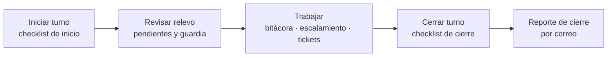
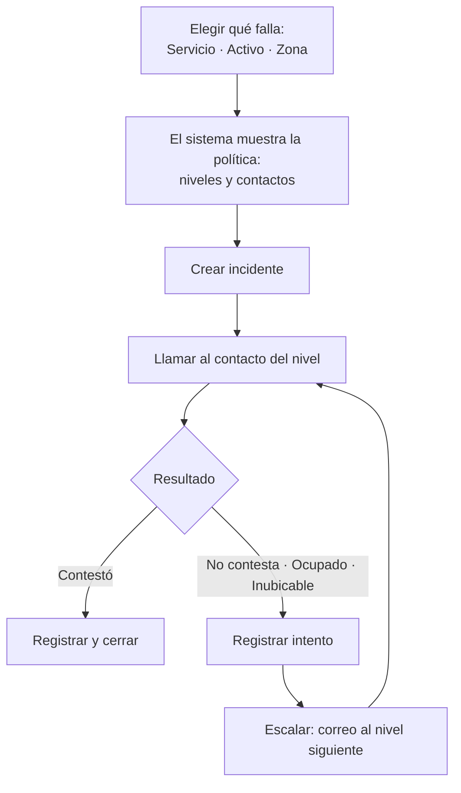

# Guía de uso

Qué hace cada pantalla de Bitácora Ops y cómo se usa en el día a día. Las pantallas que ves dependen de los módulos encendidos (SOC, NOC, Ticketera) y de tu rol. Lo que no te corresponde no aparece en el menú.

- [Roles](#roles)
- [Ingreso y perfil](#ingreso-y-perfil)
- [Un turno típico](#un-turno-típico)
- [Bitácora](#bitácora)
- [Turnos y Checklist](#turnos-y-checklist)
- [Escalamiento](#escalamiento)
- [Directorio](#directorio)
- [Reportes](#reportes)
- [Ticketera](#ticketera)
- [Complementos](#complementos)
- [Administración](#administración)
- [Atajos y accesibilidad](#atajos-y-accesibilidad)

---

## Roles

| Rol | Qué puede hacer |
| --- | --- |
| **Administrador** | Todo, incluida la sección Administración. |
| **Analista** (`user`) | Operar: registrar en la bitácora, hacer el checklist, escalar, enviar reportes, registrar mantenciones y trabajar tickets. |
| **Auditor** | Lo mismo que un analista en las pantallas de trabajo, más consultar y exportar la **Auditoría**. No puede enviar reportes ni registrar mantenciones, y no aparece en la Dotación. |
| **Invitado** | Cuentas temporales con fecha de vencimiento que vienen del legacy. En la 2.0 no se crean invitados nuevos: los usuarios nuevos son administrador, analista o auditor. |

Además del rol, cada usuario pertenece a **grupos de permisos**. Los grupos definen su alcance (SOC, NOC o ambos) y le dan capacidades puntuales, por ejemplo:

- editar o borrar en el Directorio,
- cambiar el cliente de un ticket,
- ser **jefatura de área** (ver *Mi equipo*).

---

## Ingreso y perfil

- **Login** con usuario y contraseña. Si la cuenta tiene **MFA**, se pide además el código de 6 dígitos de la app autenticadora.
- **¿Olvidaste tu contraseña?** envía un enlace por correo para crear una nueva.
- Si un administrador te obliga a cambiar la contraseña, la app solo te deja hacer eso hasta que la cambies.
- La sesión dura **8 horas**.
- Tras **5 intentos fallidos** desde la misma red, el login se bloquea 15 minutos.

**Mi perfil** (menú de tu nombre, abajo a la izquierda) tiene estas pestañas:

| Pestaña | Qué hay |
| --- | --- |
| **Datos** | Nombre, correo, cargo y último ingreso. |
| **Seguridad** | Cambiar contraseña (con medidor de fortaleza) y activar o desactivar MFA con un código QR. |
| **Preferencias** | Idioma (ES/EN), tema (claro, oscuro, rosa) y fuente para dislexia. |
| **Notificaciones** | Qué te llega como aviso emergente o por correo, el resumen diario y las notificaciones del navegador. |
| **Calendario** | Tu enlace para ver tus vencimientos de la Agenda en Outlook o Google Calendar (solo lectura), con los pasos para agregarlo. Es personal: «Generar uno nuevo» deja inútil el anterior. Aparece cuando el admin prende «Calendario en Outlook» en Funcionalidades. |

---

## Un turno típico

1. En **Turnos y Checklist → Mi turno** haces el **checklist de inicio**.
2. Revisas el **relevo**: pendientes del turno anterior, quién está de guardia y las mantenciones en curso.
3. Durante el turno registras todo en la **Bitácora**. Si algo falla, usas **Escalamiento**; si hay que darle seguimiento, creas un **ticket**.
4. Al terminar haces el **checklist de cierre**. El sistema arma y envía el **reporte de cierre** a los destinatarios del turno.

---

## Bitácora

Es el registro del turno. Cada **entrada** tiene un tipo, un texto en Markdown y, si corresponde:

- un **cliente** o servicio (SOC) o un **activo** o **zona** (NOC),
- etiquetas,
- imágenes de evidencia.

| Tipo | Para qué |
| --- | --- |
| Operativa | Lo normal del turno. |
| Incidente | Algo que afecta un servicio. Las aperturas de escalamiento crean una entrada de este tipo sola. |
| Ofensa | Alertas de seguridad (SOC). |
| Checklist | Las genera el checklist de turno. |

**Qué se puede hacer con las entradas:**

- **Buscar y filtrar** por texto, tipo y alcance; **Mías** muestra solo las tuyas; en **Más filtros**, autor, cliente, etiqueta y fechas. El cliente sale del servicio o del activo de la entrada (las que vienen del legacy con un cliente de varios servicios, de su etiqueta `cliente:…`).
- **Etiquetas**: al escribir, se sugieren las que ya existen, las más usadas primero. El administrador las renombra (si el nombre nuevo ya existe, se juntan) o las borra en **Administración → Etiquetas**.
- **Seguimiento**: comentarios sobre la entrada.
- **Crear ticket** o **vincular a un ticket** existente al escribir. En el detalle de una entrada ya guardada, **Enlazar ticket** la une a un ticket **interno** (con la Ticketera encendida) o de **GLPI** por su número; se ve ahí mismo (el de GLPI abre su ficha si GLPI está configurado) y se quita con el ícono de enlace roto.
- **Neutralizar** (*defang*) enlaces, dominios, correos e IPs: `https` pasa a `hxxps`, `www.malo.com` a `www[.]malo[.]com` y `1.2.3.4` a `1[.]2[.]3[.]4`, para que nadie los abra por error. Los nombres de archivo (`hola.zip`, `reporte.pdf`) no se tocan. Al lado del botón dice cuántos neutralizó. En Reportes, el mismo botón revisa todos los campos de texto del informe.
- **Exportar a CSV** (cualquier usuario) y acciones en lote (solo administrador).
- **Borradores**: lo que escribes se guarda solo y se sincroniza entre pestañas.

Al costado hay dos libretas:

- **Pizarrón de la sala**: lo ve toda la sala y solo lo editan los administradores.
- **Mi libreta**: notas que solo ves tú.

Si un cliente tiene **avisos** configurados (por ejemplo "no llamar después de las 22:00"), aparecen al elegir ese cliente y hay que darlos por leídos.

---

## Turnos y Checklist

Tiene tres pestañas.

### Mi turno

- **Checklist de inicio y de cierre.** Cada servicio se marca en verde o en rojo; un rojo pide una observación. Los ítems en rojo avisan por correo a los cargos configurados.
- **Relevo.** Pendientes del turno anterior, quién está de **guardia** ahora, mantenciones en curso y si alguna suprime avisos.
- **Cierre de turno.** Muestra el balance del turno (entradas, incidentes, checklist) y envía el **reporte de cierre** a los destinatarios del turno de trabajo. Si el turno no tiene destinatarios, lo avisa.

### Historial

Checklists anteriores con fecha, turno, analista y resultado. Se pueden filtrar los que tuvieron servicios en rojo y descargar en PDF. El administrador puede **borrar** un checklist (por ejemplo, uno duplicado) escribiendo el motivo; queda en Auditoría con todo su contenido. El checklist con que se cerró un turno no se borra.

### Dotación (TV)

Matriz del personal por día: quién trabaja, teletrabajo, vacaciones, licencias y trámites médicos. Está pensada para mostrarse en una pantalla de la sala. Se puede compartir con un **enlace público** sin login.

---

## Escalamiento

Responde **"¿a quién llamo?"** y deja constancia de cada intento.

> **La aplicación no hace llamadas.** Las llamadas se hacen a mano desde el teléfono de guardia. Aquí se registra el resultado y, al escalar, el sistema avisa **por correo** al nivel siguiente.

1. **Elige qué falla.** *Servicio* viene seleccionado por defecto porque es lo más usado. Al escribir, el buscador va proponiendo; en zonas busca sin importar tildes.
2. El sistema busca la **política de escalamiento**. Si el servicio no tiene una, sube por su zona y las zonas superiores, o usa el equipo que cubre la zona. Muestra los **niveles**, sus contactos con sus canales, quién está **de guardia**, si hay **mantención** y el tiempo antes de pasar al siguiente nivel.
3. **Crea el incidente.** Queda enlazado a una **entrada de la bitácora** ("Ver en la bitácora") donde se anota cada intento, nota, cierre y reapertura.
4. **Registra cada intento**: contestó, no contesta, ocupado o inubicable, con una nota opcional.
5. **Escalar** marca el nivel como escalado y envía un correo al nivel siguiente con tu nota.

Ver a quién llamar queda registrado en la Auditoría.

**Matriz RACI:** el botón **RACI** muestra, por cliente, quién es **responsable** (R), quién **aprueba** (A), a quién se **consulta** (C) y a quién se **informa** (I) en cada actividad, agrupadas por tópico, con las **notas** (por ejemplo, a qué canal avisar después de cierta hora). Parte con el cliente del servicio que estás mirando. Un clic en un correo lo copia y el teléfono se puede marcar. La matriz la edita el admin en Administración → Matriz RACI.

**Ventanas de mantenimiento:** cualquier analista las programa y las cierra. Aplican a un servicio, un activo, una zona, un **cliente** (todos sus servicios), un **área** o un **equipo** de la app; con «suprimir» el escalamiento anota sin enviar el aviso. Una ventana en curso se cierra antes de tiempo con **Cerrar ahora** (queda registrado quién y cuándo); una programada se **cancela**. Se ven también en el calendario de la Agenda. Con **Se repite** una ventana vuelve cada semana (días y horario; si termina antes de empezar, pasa la medianoche) o cada mes (un día fijo o «el tercer domingo»), con fecha de inicio y de término opcional; abajo se ven las próximas. En **Ventanas que se repiten** cada una se puede **saltar esta vez**. La que cae en **feriado no se aplica**; si es urgente, la jefatura o el admin pulsa **Aplicar igual** y queda quién la aplicó.

---

## Mapa

Solo con el módulo NOC y para el perfil Operativo. Muestra las localidades del Territorio que tienen coordenadas y, a la derecha, los **sectores a revisar**:

- **Rojo:** la localidad (o un activo de ella) tiene un incidente de escalamiento abierto.
- **Ámbar:** tiene una ventana de mantenimiento activa en este momento.
- **Azul:** tiene tickets abiertos con ese lugar (solo con la Ticketera encendida).

Si una localidad tiene varias cosas, el punto toma el color más grave y la lista las muestra todas («1 incidente · 2 tickets»).

«A revisar» deja solo esas; «Todas» muestra también las que están sin novedad, en gris. Los botones *Incidentes abiertos*, *Mantenimiento* y *Tickets abiertos* encienden o apagan cada color. Al elegir un sector (en la lista o en el mapa) se ve qué equipos lo cubren, sus incidentes, mantenimientos y tickets (un clic abre el ticket), y **Ver escalamiento** abre Escalamiento con esa localidad elegida. El mapa se actualiza solo cada minuto mientras está a la vista.

---

## Inventario

Los equipos de tu área (dueña o responsable): servidores, computadores, equipos de red, enlaces, sitios… El admin y el perfil Gestión ven todos («Todas»).

- **Ficha:** los datos de su tipo (un servidor: SO, versión, CPU, RAM, disco; un equipo de red: sistema, versión, puertos, PoE, rol, stack, VLAN de gestión), **varias IP** con su tipo (Red, Balanceo VIP, Administración iLO/iDRAC u Otra), **responsables** (un área, una persona o una organización externa, con de qué se encarga: por ejemplo TI configura, Infra el hardware, Datahouse la energía y la conectividad), marca y modelo, serie, cliente, localidad (opcional), rack y posición, y «otros datos» libres.
- **Historial:** queda solo cada cambio de ficha («SO: 20.04 → 24.04»), cada **Registrar trabajo** y cada ticket resuelto cuyo lugar es el equipo. La pestaña **Tickets** muestra los tickets que lo tuvieron como lugar.
- **Dar de baja o borrar:** lo hace el admin o la jefatura del área dueña. Los demás usan **Pedir baja** o **Pedir borrado** con un motivo; a quien decide le aparece el número en el menú (Inventario) y acepta o rechaza en **Solicitudes**. Un equipo con registros en la bitácora o en escalamiento no se borra: se da de baja.
- **De GLPI:** con la importación desde GLPI encendida, los equipos importados muestran «GLPI #id» y el filtro **De GLPI** los separa. En la ficha, los datos con una nube los actualiza GLPI en cada importación (nombre, serie, modelo, SO, CPU, RAM, disco, IP de red, cliente y localidad, cuando GLPI los trae); área, responsables, rack e historial son de la Bitácora. Si el equipo se borra en GLPI, queda dado de baja; si vuelve, se reactiva solo.
- **Cargar CSV:** se elige el tipo, se baja la plantilla, se llena en Excel y se sube. Antes de guardar se ve fila por fila qué pasará; cada equipo se busca por su código (se actualiza si existe, se crea si no) y las filas con error no entran. En una celda van varios valores separados por «;»: `ips` = `Red=10.10.4.21; VIP=10.10.4.20; iLO=10.10.99.21`, `responsables` = `Configuración y sistema=área:TI; Energía y conectividad=org:Datahouse`. El archivo no se guarda. **Exportar lo que hay** baja el inventario en el mismo formato.

---

## Agenda

Todo lo que hay que hacer para una fecha: el informe mensual de un cliente, el respaldo de los switches el último día hábil, la acción que pide un CSM o un pendiente propio. La ven todos los perfiles.

- **Mis pendientes:** lo tuyo, lo de tu nivel («N1 de Infra») y lo de tu guardia cuando estás de guardia, ordenado por vencimiento: atrasadas, hoy, próximos 3 días hábiles, más adelante y lo que cerraste hoy. Lo que va a un nivel aparece **sin tomar**: el primero que aprieta **Tomar** se queda con ella.
- **Detalle:** cuándo vence (a las 20:00 del día), quién la tiene, cuándo se repite y quién la asignó. Los **pasos** se marcan como un checklist. **Marcar hecha** pide una nota y un enlace opcionales; **Omitir** pide un motivo (lo pueden hacer el responsable o quien la asignó); también **Traspasar** a alguien del área, **Devolver al nivel** y **Reabrir**.
- **Calendario:** mes y semana, con fines de semana y feriados sombreados, por área, cliente o solo las tuyas.
- **Gestión:** lo que asignaste y cómo va (a tiempo, en riesgo, atrasada), con las últimas veces de cada tarea recurrente e indicadores de 90 días. La jefatura ve además todo su área.
- **Nueva tarea:** quién la hace (una persona, un nivel o quien esté de guardia) y cuándo: una vez, cada N días, semanal, el día hábil N del mes, el último día hábil o un día fijo que se adelanta o posterga si no es hábil. Abajo se ven las próximas fechas, con las que se corrieron por un feriado. Puedes asignarte a ti y a los niveles de abajo de tu área; **hacia arriba no** (se pide con un ticket). La jefatura asigna a todo su área, y Gestión (CSM) y las jefaturas también a otras áreas.
- **Se cierra sola:** una tarea con cliente puede quedar ligada a un informe de Reportes; al enviárselo a ese cliente, queda hecha.
- **Ausencias:** si quien tiene una tarea está de vacaciones o con licencia en Dotación ese día, vuelve a su nivel.
- **Cierre de turno:** el popup de cierre muestra tus tareas abiertas que vencen hasta el siguiente día hábil, para quedártelas, pasarlas a quien entra o devolverlas al nivel.
- Si el cliente de una tarea se desactiva, sus tareas recurrentes se pausan hasta reactivarlo.
- **Ventana de mantenimiento desde una tarea:** en una tarea de una vez se puede marcar «Crear ventana de mantenimiento» con hora de inicio y fin. Aplica al cliente de la tarea (o a su área) y se mueve con la tarea si cambia de fecha. Las ventanas se ven en el calendario.
- **Flujos** (pestaña): tareas de varias áreas en orden, por ejemplo Infra instala el rack → TI configura la red → CSM avisa al cliente. **Flujo nuevo** pide el nombre, el cliente, cuándo empieza (una vez o cada cierto tiempo) y los pasos, cada uno con su área, quién lo hace y cómo empieza:
  - **Al terminar el anterior:** espera, y cuando el anterior se marca hecho (u omitido) vence en los días hábiles que pusiste. Si el anterior se atrasa, este se corre. A su responsable le llega el aviso en ese momento.
  - **En paralelo:** vence en esos días hábiles desde que empieza el flujo, aunque el anterior no haya terminado.
  Cada paso se hace desde Mis pendientes de su responsable, como cualquier tarea; lo que espera aparece en **En espera**, con a qué espera. En la pestaña se ve cada flujo con sus pasos unidos por flechas (punteada si va en paralelo), en qué paso va y si está a tiempo. Arma flujos con otras áreas quien puede asignarles tareas (jefaturas, Gestión y admin); lo edita quien lo creó.

---

## Notificaciones

Lo mismo nunca llega por todos los canales a la vez.

- **Campana**, junto a tu nombre en la barra lateral: el registro de todo, con el número de no leídas en vivo. Cada aviso lleva a lo suyo (la tarea, el ticket). Los avisos iguales se agrupan («3 tareas vencen hoy»). «Marcar todas leídas» la deja en cero. Guarda 90 días.
- **Aviso emergente**, abajo a la derecha, con la app abierta: «Ver» lleva a lo suyo y «Más tarde» lo deja en la campana. Se va solo y nunca bloquea.
- **Inicio de turno**: el popup muestra «Hoy vencen 3 tareas y tienes 1 atrasada».
- **Correo**: el **resumen diario** a las 08:00 de los días hábiles, solo si tienes algo, y al instante solo los atrasos (y los avisos antes del vencimiento, si lo dejas así).
- **Notificaciones del navegador** (opcional): sirven con la app en otra pestaña; el navegador pide permiso.

Qué avisa: en la **Agenda**, que te asignaron una tarea (a ti, a tu nivel o a tu guardia), los avisos antes del vencimiento, «vence hoy», el atraso (solo al responsable), un traspaso, y a la jefatura cuando una ausencia devuelve una tarea al nivel. En **Tickets**, que te asignaron uno o te sumaron como resolutor, que derivaron uno a tu área y que comentaron uno tuyo. En **Inventario**, una solicitud de baja que decides. Y cuando empieza o termina una **ventana de mantenimiento** de tu área.

**Mis preferencias:** en Mi perfil → Notificaciones (o con el ícono de ajustes de la campana) eliges, por tipo, si te llega como aviso emergente y por correo, el resumen diario y las notificaciones del navegador. Lo que tiene candado lo fijó el admin y no se apaga.

**Avisos con acuse:** lo importante sale en una ventana al centro que solo se cierra con **Leído**; lo que estabas escribiendo sigue ahí. Si hay varios, salen uno tras otro. Quedan en la campana para volver a leerlos. Los envían el admin, la jefatura de área y quien tenga el permiso «Enviar avisos con acuse», desde la campana → **Avisos con acuse**: título, texto (markdown), a quién (personas, un nivel de un área, áreas enteras o todos), ahora o programado, y opcionalmente cuándo deja de aparecer. Ahí mismo se ve el avance («12 de 15 leyeron»), quién falta, y se les puede recordar por correo.

---

## Directorio

Contactos **internos** (sincronizados desde los usuarios de la app) y **externos** (contratas, clientes, proveedores). Cada contacto tiene sus canales: llamada, WhatsApp, SMS, correo u otro.

- Buscar, filtrar por organización y marcar **favoritos**.
- Clic en un teléfono o correo para **copiarlo**.
- **Agregar, editar, importar y exportar CSV**: requiere el permiso de escritura del Directorio. **Exportar CSV** descarga lo filtrado con las columnas de la plantilla, así se puede corregir en Excel y volver a importar; queda en Auditoría. **Borrar** requiere el permiso de borrado. **Consolidar duplicados** es solo del administrador.
- Los contactos sincronizados desde un usuario se editan desde la cuenta de ese usuario.

Consultar el Directorio queda registrado en la Auditoría. No se guarda lo buscado, porque puede ser un teléfono o un correo.

---

## Reportes

Informes por correo para clientes, con dos modos:

| Modo | Para qué |
| --- | --- |
| **Incidente** | Informe de un evento: nombre del evento, motivo, origen y destino, evidencia, impacto, mitigación y recomendación. Al escribir el nombre, **sugiere eventos del catálogo** y rellena el motivo con su texto por defecto. |
| **Boletín** | Comunicado general: título, nivel de alerta, productos afectados y referencias. |

- La **vista previa** se actualiza mientras escribes y usa el mismo formato de correo de siempre.
- **Destinatarios**: se escriben a mano o se toman del Directorio, con CC.
- **Neutralizar**: cambia `http` por `hxxp` y los puntos de IPs y dominios por `[.]`.
- Imágenes de evidencia, copiar como HTML o Markdown, y **borrador** automático.
- **Historial**: los envíos anteriores con su estado; se pueden reenviar.

---

## Ticketera

Tickets ITIL de **incidente** o **requerimiento**. Solo aparece si el módulo Ticketera está encendido.

Un clic en el **número** del ticket (en la lista o arriba del detalle) lo copia; por un momento dice «Copiado».

Las entradas de la Bitácora vinculadas al ticket (pestaña **Bitácora**, o «Ver la entrada» en la actividad) se abren en un popup sin salir del ticket; desde ahí, **Abrir en la Bitácora** lleva a la entrada.

**Colas por área:** arriba eliges qué mirar.

- **Cola de mi área:** lo que resuelve tu área; lo trabajas.
- **Pedidos por mi área:** lo que tu área le pidió a otras. Ves el avance y comentas, pero lo trabaja la otra área.
- **Todas las áreas:** solo el administrador y el perfil Gestión (CSM).

Quien todavía no tiene grupos ni áreas ve todos los tickets, como antes.

| Concepto | Cómo funciona |
| --- | --- |
| **Prioridad** | Sale de impacto × urgencia (P1 crítica a P4 baja). |
| **SLA** | Plazos de respuesta y resolución por prioridad (se configuran en Administración → Ticketera). Se **pausa** mientras se espera al proveedor y muestra si está en riesgo o vencido. |
| **Estados** | Nuevo → Asignado → En curso → Esperando proveedor → Resuelto → Cerrado (o Cancelado). |
| **Asignación** | Equipo y resolutores. Cualquier analista puede tomar o asignar. |
| **Tareas** | Lista de pasos dentro del ticket, con tiempo. |
| **Comentarios** | Internos o públicos, en Markdown, con imágenes. |
| **Área** | Cada ticket está en la **cola de un área** (la que lo resuelve) y recuerda el **área que lo pidió**. Al crearlo parte en tu área; si eliges otra, le estás pidiendo algo a esa área. **Derivar a otra área** pide un motivo, queda en la actividad y el ticket entra a esa cola como Nuevo, sin equipo ni resolutores (el SLA sigue). |
| **Lugar** | Opcional, con el módulo NOC: una localidad del Territorio o un activo (con un activo, la localidad sale sola). Se elige al crear el ticket o en su panel; aparece en la lista y en el Mapa (capa *Tickets abiertos*). El cliente no lo ve en el seguimiento público. |

**Relaciones entre tickets:**

- **Unir duplicados** ("Unir con…"): pueden hacerlo el administrador o quien creó cualquiera de los dos. Todo el historial pasa al ticket que queda; el otro se cierra como "Unido a…". No se deshace.
- **Padre e hijos** (un solo nivel):
  - Un comentario en el padre puede enviarse también a los hijos abiertos.
  - Esperar al proveedor en el padre pausa a los hijos.
  - Resolver el padre ofrece resolver los hijos.
  - Los cambios de los hijos se ven en el padre, con "X de N resueltos".
- **Cambiar cliente**, si se registró mal: requiere el permiso "Cambiar el cliente de un ticket" y un motivo. Renueva el enlace público y su PIN.

**Enlace público:** cada ticket tiene un enlace con **PIN** para que el cliente vea el avance en 3 pasos y los comunicados públicos, sin cuenta. Tras 30 PIN incorrectos en 15 minutos, el enlace se bloquea un rato.

**Avisos por correo** (si están encendidos en Administración → Ticketera):

- **Al equipo:** copia de respaldo al crear el ticket, al responsable cuando se le asigna, SLA vencido o por vencer, reabierto, unido y cliente cambiado. Quien hace el cambio no recibe el aviso de su propia acción.
- **Al cliente:** solo en tickets con **Afecta al cliente** (viene marcado en P1 y P2). Le llega al abrir, en cada comentario visible al cliente (los seguidos se juntan en un correo) y al resolver. Nunca lleva comentarios internos ni nombres de técnicos.
- **En el ticket:** la casilla *Afecta al cliente*, *Avisar a* (Para/CC del escalamiento del cliente, editable solo para ese ticket) y *Correos enviados*, con *Reenviar* si uno falló.

---

## Complementos

Mini-aplicaciones propias (herramientas, diccionarios, utilidades) que se abren dentro de Bitácora Ops. Corren en un **origen aislado**, así que no pueden leer tu sesión. Solo aparecen si la funcionalidad *Complementos* está encendida.

---

## Mi equipo

Solo para la **jefatura de área**: quien tiene un grupo con la capacidad *Jefatura de área* (se marca en Usuarios y grupos → Grupos). Si es jefatura de más de un área, elige el área arriba.

- Arriba: personas activas, tickets abiertos, SLA vencidos y ausentes hoy (vacaciones o licencia en Dotación).
- La lista muestra el grupo de cada persona, cómo está hoy (oficina, teletrabajo, guardia, vacaciones, licencia), sus tickets abiertos y los vencidos.
- Al elegir a una persona: su semana, sus tickets (se abren con un clic), cambiarle el grupo y darla de baja o reactivarla.
- **Agregar persona:** nombre, usuario, correo y un grupo del área. La app genera una contraseña temporal que se muestra **una sola vez**: entrégasela tú. La persona la cambia al primer ingreso.
- La jefatura solo asigna grupos de sus áreas, nunca da permisos de administrador y no toca a administradores ni a quien tiene grupos de otras áreas. Todo queda en Auditoría.
- **Guardias** (pestaña): las guardias del área, quién está en cada una (sumar o sacar personas del área) y «Nueva guardia». Abajo, la misma línea de tiempo de Administración para asignar fechas, generar la rotación y poner reemplazos.
- **Escalamiento** (pestaña): las políticas del área, con sus llamados y el recordatorio. Las nuevas nacen en el área.
- **Resumen mensual** (pestaña): por persona y total del área, las tareas a tiempo, los atrasos que quedaron abiertos, las omitidas, los tickets resueltos dentro del SLA y los días ausente, con la diferencia contra el mes anterior. Abre en el mes pasado; con las flechas se ven hasta 12 meses atrás. El primer día hábil del mes siguiente el mes se **congela**: lo enviado ya no cambia aunque alguien reabra una tarea vieja. No llega solo: **Enviar por correo** a quien elijas (correos de la empresa) o **Descargar PDF**.

Cada guardia y cada política tiene un **área dueña**: la gente del área la ve (en Turnos y Escalamiento) y su jefatura la edita. La gente de TI o Infraestructura ve en Turnos las pestañas Guardias (solo mirar) y Dotación de su área.

---

## Administración

Solo para administradores. El menú se agrupa así:

| Grupo | Sección | Lo esencial |
| --- | --- | --- |
| Personas | **Usuarios y grupos** | Usuarios y roles; en el panel de cada persona, su **nivel en cada área** («—» = fuera; puede estar en varias), **Jefe** por área y permisos extra: los grupos se arman solos. También cargos, largo mínimo de contraseña (6 por defecto) y correos de cumpleaños (con **Cambiar imagen** se usa una imagen propia en el correo; **Volver a la original** deja la de la app). La pestaña Grupos queda para casos raros. |
| | **Áreas y niveles** | Todo lo de la **gente** de cada área. A la izquierda las áreas (y «Nueva área», «Niveles»); al elegir una se abre su ficha: **Personas** (nivel, Jefe, permisos extra; agregar a alguien que ya existe o a una persona nueva; sacar del área), **Guardias** y **Escalamiento** del área, más su perfil y si está activa. Un área es gente: apagarla no apaga funciones (eso es Módulos). |
| Operación | **Turnos** | Guardias, turnos de trabajo (con flechas para cambiar el orden en que se ven en todas las pantallas), dotación programada, recordatorios y avisos (detalle abajo). |
| | **Checklist** | Plantillas de inicio y cierre, servicios y alertas de ítems en rojo. |
| | **Escalamiento** | Políticas por servicio, activo o zona, con sus llamados en orden (detalle abajo). |
| | **Matriz RACI** | Por cliente, cada actividad con su tópico, sus notas y las cuatro letras: un solo **aprobador** (A), al menos un **responsable** (R) y los **consultados** e **informados** que hagan falta. Cada letra puede ser una guardia o lista que ya existe, una persona del directorio o una persona nueva (queda en el directorio del cliente). Los analistas la ven en Escalamiento. |
| | **Ticketera** | Plazos de SLA por prioridad, umbral "en riesgo", firma ante el cliente, avisos por correo y **Numeración** (solo con la Ticketera encendida). En Numeración se arma cómo se ve el número: prefijo, con año (2026), año corto (26) o sin año, cuántos dígitos y desde qué número sigue (solo puede subir), con una vista previa. Hay una **general** y se pueden crear otras; abajo se elige cuál usa cada área (varias pueden compartir una). Numera el **área que pide** el ticket, el correlativo nunca vuelve a 1 y los tickets que ya existen conservan su número. En **Áreas y niveles**, la ficha de cada área muestra su numeración (solo vista). |
| | **Avisos por cliente** | Avisos que aparecen al trabajar con un cliente y el catálogo de eventos de los informes, que también se **importa** desde un .csv (columnas nombre, categoria, motivo) o .json; lo que ya existe se salta. |
| | **Correo** | SMTP y remitente, con plantillas para los proveedores comunes y correo de prueba. |
| | **Reportes de turno** | Formato y estado de los reportes de cierre. |
| | **Notificaciones** | La hora del resumen diario, lo que nadie puede apagar (por defecto los atrasos y los avisos con acuse), cada cuántos minutos se agrupan los avisos iguales y cuántos días guarda la campana. |
| | **Agenda** | Horario hábil con que la Agenda calcula vencimientos y avisos (por defecto lunes a viernes de 08:00 a 20:00; no cambia turnos ni guardias) y los feriados por año: se importan los de Chile incluidos en la app y se agregan o quitan a mano. |
| Catálogos | **Organizaciones y servicios** | Clientes, tipos, servicios y fuentes de log. Una fuente de log se puede borrar si ningún equipo del inventario la usa; si no, se desactiva. |
| | **Territorio** (NOC) | Regiones, zonas y sitios, con importación CSV y activar o desactivar en lote. Para el Mapa: el **fondo** (OpenStreetMap público, servidor propio o sin fondo) y **Sin ubicación**, donde se ubica con un clic en el mapa cada localidad que no tiene coordenadas. |
| | **Inventario** | Tipos de equipo y sus campos (texto, número, lista o fecha), y la lista de tipos de responsabilidad. Quitar un campo no borra lo cargado. |
| | **Equipos** | Equipos, contratas, guardias, integrantes y cobertura territorial, con acciones en lote (detalle abajo). |
| Sistema | **Marca** | Nombre, logo, favicon y fuente. |
| | **Módulos** y **Funcionalidades** | Qué partes del sistema están encendidas (SOC, NOC y la Ticketera se encienden y apagan en Módulos). |
| | **GLPI** | Con «Sincronización con GLPI» encendida: la conexión con GLPI y su prueba (si falla, dice la causa probable y qué hacer), qué se trae y cómo se reparte (tipo, área dueña, entidad → cliente), la importación automática y **Revisar ahora**, que muestra qué se crea, qué cambia (antes → después), qué se da de baja y qué se salta antes de **Importar**. Un equipo que ya existe en la app con la misma serie se salta; **Vincular** hace que desde ahí lo actualice GLPI. Si la automática falla, o si de una vez desaparece más del 10 % de lo importado (no lo da de baja), avisa en la campana a los administradores. |
| | **Respaldos** | Copias, restauración y exportación (ver [operacion.md](operacion.md)). |
| | **Auditoría** | Quién hizo qué y cuándo, con filtros por categoría y por evento exacto, y exportación. |
| | **Complementos** | Subir y publicar mini-aplicaciones. |

### Escalamiento → llamados de una política

Cada política (de un servicio, un activo o una zona) es una lista de **llamados** en orden: "Aviso por correo (PARA y CC)", "1er llamado", "2do llamado"…

- Cada llamado avisa a **personas del Directorio** (o a un **pool** con nombre), o a **un equipo** real: una guardia, una contrata.
- **Persona del Directorio:** escribe un nombre y elígelo. Las personas no se copian: si cambias un teléfono en el Directorio, cambia en todas las políticas.
- Con varias personas en un llamado eliges cómo se avisa: una por vez, en orden, o todas a la vez (pool).
- **"Si no contesta, pasar en N min":** el tiempo antes de pasar al llamado siguiente.
- Las flechas reordenan los llamados y el basurero quita uno; los demás se renumeran solos.
- Todo se guarda al momento, sin botón "Guardar".

### Equipos

- Los equipos se ven **agrupados por organización**, con filtro por tipo (escalamiento, guardia, RACI…) y búsqueda.
- Cada equipo dice **qué lo usa**: políticas ("QRadar · DPP #2"), RACI, guardias o tickets.
- **Selección en lote:** marca equipos (o una organización entera) y elige **Activar**, **Desactivar** o **Borrar…**.
- **Borrar** primero avisa qué se lleva cada equipo. Si confirmas, se borra en cascada: sus llamados en las políticas, su RACI y sus guardias. Los tickets se conservan, solo quedan sin equipo asignado. **Los contactos del Directorio nunca se borran.** Si prefieres no perder nada, usa "Solo desactivar".
- **Organización desactivada:** sus equipos se desactivan y se ocultan (filtro "Ver de organizaciones desactivadas"). Al reactivarla, vuelven los que ella había apagado.
- Los llamados de las políticas **no aparecen aquí**: se editan en Escalamiento.
- Clic en un equipo abre sus integrantes al lado. Otro clic lo cierra.

### Turnos → Guardias

La pantalla para organizar las guardias (N2, TI, N1 No hábil…) y marcar condiciones de una persona (teletrabajo, charla/capacitación, vacaciones, licencias), todo desde "Nueva asignación".

- **Ahora de guardia:** quién está en cada guardia, hasta cuándo y quién sigue.
- **Línea de tiempo** de 2 o 4 semanas, con una línea roja en "ahora".
  - Las barras se ven en curso, próximas, pasadas o como reemplazo.
  - Si hay dos personas a la vez, sus barras se apilan.
  - Clic en una barra para editarla.
- **Siempre cubierta:** N1 y N2 no pueden quedar sin nadie. Un tramo vacío se marca en rojo y se cubre con un clic.
- **Nueva asignación:** en el mismo selector están las guardias y las condiciones, como en el legacy.
  - Una guardia: eliges la persona (cada integrante muestra si está libre, en otra guardia o de vacaciones) y el tramo, con duraciones rápidas (1 semana, 2 semanas, 2 días).
  - Una condición (teletrabajo, charla/capacitación, vacaciones, trámite médico, licencia): persona, desde y hasta; queda en Dotación.
- **Antes de guardar** el panel avisa si:
  - la persona ya está en otra guardia,
  - tiene una ausencia en Dotación,
  - quedan dos personas a la vez,
  - queda un hueco antes o después.
- **Reemplazo por unos días:** pone a otra persona en un tramo sin cambiar la guardia. Un clic en un reemplazo (barra rayada) lo abre para cambiar quién reemplaza, las fechas o el motivo, o para borrarlo.
- **Generar rotación:** marcas a las personas, las ordenas y eliges desde cuándo, cuánto dura cada una y cuántas crear. La vista previa avisa de ausencias y cruces.
- **Configurar** (ícono junto a cada guardia):
  - si debe estar siempre cubierta,
  - el día de cambio,
  - la hora de cambio, que sale del turno de trabajo enlazado (sin turno enlazado, 09:00).
- **Cargar CSV:** la carga masiva con la misma plantilla del legacy (`condicion,usuario,fechaInicio,horaInicio,fechaFin,horaFin`).
  - Las guardias van a la línea de tiempo.
  - Teletrabajo, vacaciones, trámite médico y licencia van a Dotación.
  - Informa los errores fila por fila.
- **Próximos relevos** y **Revisión** de las próximas 4 semanas: cada problema viene con un botón para resolverlo.

### Turnos → Avisos

Dos correos que también mandaba el legacy:

- **Checklist no realizado:** si a la hora elegida (09:30) nadie hizo el checklist de inicio del día, avisa a quien esté de guardia en la guardia elegida (N1 no hábil) y a las personas con los cargos elegidos (N2). Uno al día como máximo.
- **Guardia sin cubrir:** desde las 09:00 revisa la semana que empieza en los días elegidos (7). Si alguna de las guardias marcadas tiene un hueco, avisa a las personas con los cargos elegidos (N2). Una vez por semana revisada. Viene apagado, como en el legacy.
- Los cargos son los de cada persona (Usuarios y grupos). El último envío se ve debajo de cada aviso y cada envío queda en Auditoría.

---

## Atajos y accesibilidad

- **Atajos de navegación:** `Alt+1` Bitácora · `Alt+2` Turnos · `Alt+3` Escalamiento · `Alt+4` Directorio · `Alt+5` Administración · `Alt+8` Reportes · `Alt+9` Mi equipo (jefatura) · `Alt+0` Mapa (NOC). Están indicados junto a cada ítem del menú.
- **Buscador de Administración:** `Ctrl+K`.
- **Idioma:** botones ES / EN abajo a la izquierda.
- **Tema y fuente para dislexia (OpenDyslexic):** íconos abajo a la izquierda o en *Mi perfil → Preferencias*.
- **Ayuda de Markdown:** el ícono junto a los editores muestra cómo dar formato al texto.
